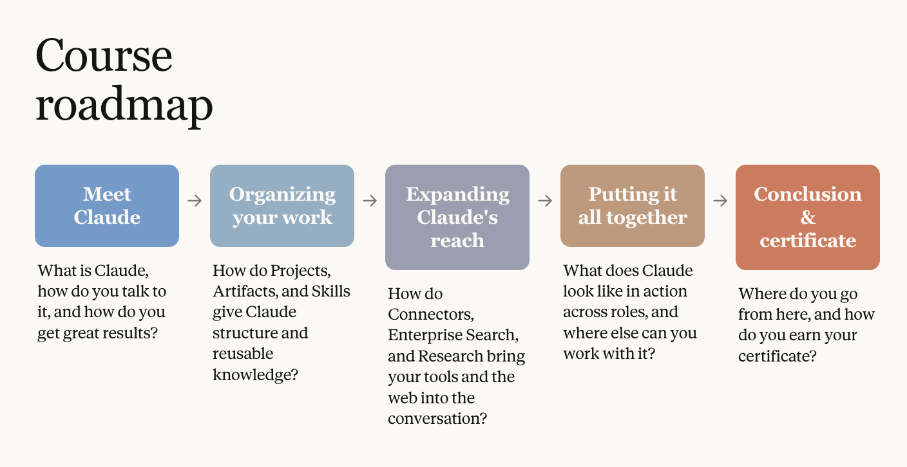

## 학습 목표

- Claude가 단순한 chatbot이 아니라 **생각을 함께 정리하는 AI assistant**라는 점 이해하기
- Claude의 설계 원칙과 잘하는 작업, 접근할 수 있는 인터페이스 구분하기
- Claude.ai에서 첫 대화를 시작하고 **효과적인 prompt의 세 요소** 익히기
- 파일과 이미지를 업로드해 Claude에게 더 많은 맥락 주기
- 후속 메시지로 Claude의 답변을 **반복 개선**하는 습관 만들기

## 한눈에 보는 흐름

<ol class="oa-flow">
  <li><strong>Claude 이해하기</strong>chatbot이 아니라 thinking partner</li>
  <li><strong>첫 대화 시작</strong>동료에게 말하듯 자연스럽게</li>
  <li><strong>좋은 prompt</strong>무대 설정 · 작업 정의 · 규칙 지정</li>
  <li><strong>맥락 더하기</strong>파일 · 이미지 · 개인 설정</li>
  <li><strong>반복 개선</strong>후속 메시지로 다듬기</li>
</ol>

이 레슨을 한 문장으로 줄이면: **Claude는 지능을 가져오고, 일을 의미 있게 만드는 맥락과 전문성은 내가 가져온다.**

### Course roadmap

Claude 101은 Claude를 처음 쓰는 사람이 Claude와 협업하는 기본기를 익히는 강의예요. 전체 흐름은 이렇게 구성돼요.



| 모듈 | 다루는 질문 |
|---|---|
| **Meet Claude** | Claude가 무엇이고, 어떻게 말을 걸고, 어떻게 좋은 결과를 얻나 |
| **Organizing your work and knowledge** | Projects와 Skills가 어떻게 구조와 재사용 가능한 지식을 주고, artifacts는 어디에 사나 |
| **Expanding Claude's reach** | Connectors, Enterprise Search, Research가 내 도구와 웹을 어떻게 대화로 가져오나 |
| **Putting it all together** | 역할별로 Claude가 어떻게 쓰이고, 또 어디서 함께 일할 수 있나 |
| **Conclusion & badge** | 다음에 어디로 가고, badge는 어떻게 받나 |

이번 레슨은 첫 모듈 `Meet Claude`의 앞부분이에요. Claude가 무엇인지, 어떻게 말을 걸면 좋은지부터 시작해요.

## 1. Claude는 무엇인가요?

<div class="oa-eli">
  <span class="oa-eli__head">🧑‍🤝‍🧑 쉽게 말하면</span>
  <p>자판기는 버튼을 누르면 정해진 음료만 나와요. Claude는 자판기가 아니라 <b>옆자리의 똑똑한 동료</b>에 가까워요. 상황을 설명하면 같이 고민하고, 초안을 쓰고, "이건 어때요?" 하고 되물어 주죠.</p>
</div>

Claude는 단순히 질문에 답하는 chatbot이 아니에요. 요약, 검색, 창의적·협업적 글쓰기, Q&A, 코딩처럼 다양한 작업을 높은 신뢰성과 예측 가능성으로 해내는 **AI assistant**예요.

<div class="oa-vs">
  <div class="oa-vs__bad">
    <span class="oa-vs__label">❌ 정답을 묻는 도구로만 보기</span>
    <ul>
      <li>단순한 질문을 던지고 답만 받아 가요.</li>
      <li>맥락을 주지 않으니 일반적인 답이 나와요.</li>
    </ul>
  </div>
  <div class="oa-vs__good">
    <span class="oa-vs__label">✅ thinking partner로 보기</span>
    <ul>
      <li>나는 <b>목적 · 맥락 · 판단 기준</b>을 줘요.</li>
      <li>Claude는 그걸 바탕으로 초안 작성, 분석, 구조화, 아이디어 확장을 도와요.</li>
      <li>복잡한 문제와 까다로운 상황을 함께 풀어 가요.</li>
    </ul>
  </div>
</div>

### Claude의 설계 원칙

Anthropic은 Claude를 훈련하는 접근을 **Constitutional AI**라고 불러요. Claude가 인간의 가치와 잘 맞고, 투명하게 동작하도록 훈련하는 방식이에요.

<div class="oa-cards">
  <div class="oa-card"><span class="oa-card__icon">🛡️</span><span class="oa-card__title">유해한 출력 피하기</span>독성 있거나 차별적인 출력을 피하도록 안내돼요</div>
  <div class="oa-card"><span class="oa-card__icon">⚖️</span><span class="oa-card__title">나쁜 일 돕지 않기</span>불법적이거나 비윤리적인 행동을 돕지 않아요</div>
  <div class="oa-card"><span class="oa-card__icon">🌱</span><span class="oa-card__title">안전하고 이로운 AI</span>전반적으로 안전하고 유익한 AI system으로 행동해요</div>
  <div class="oa-card oa-card--hl"><span class="oa-card__icon">🎛️</span><span class="oa-card__title">Steerable</span>성격 · 톤 · 행동에 대한 지시를 잘 따라서, 적은 노력으로 원하는 결과를 얻어요</div>
</div>

이 원칙은 흔히 **helpful · harmless · honest** 세 단어로 요약돼요.

- **Helpful**: 사용자의 목표를 이해하고 실제로 도움이 되는 답을 주려고 해요.
- **Harmless**: 유해하거나 차별적이거나 불법·비윤리적 행동을 돕는 출력을 피하려고 해요.
- **Honest**: 모르는 것은 모른다고 말하고, 가능한 한 투명하게 답하려고 해요.

## 2. Claude가 잘하는 일

<div class="oa-eli">
  <span class="oa-eli__head">🧰 쉽게 말하면</span>
  <p>Claude는 드라이버 하나가 아니라 <b>만능 공구함</b>이에요. 글쓰기, 조사, 코딩, 추론, 학습까지 들어 있어요. 어떤 공구를 꺼낼지는 내가 맡기는 일에 따라 달라져요.</p>
</div>

Claude는 단순 Q&A를 넘어 업무를 **자동화(automate)하거나 보강(augment)**하는 데 강해요.

<div class="oa-cards">
  <div class="oa-card"><span class="oa-card__icon">✍️</span><span class="oa-card__title">글쓰기와 콘텐츠 제작</span>소셜 미디어 글, 업무 이메일, 복잡한 보고서</div>
  <div class="oa-card"><span class="oa-card__icon">🔎</span><span class="oa-card__title">조사와 분석</span>조사 방향 잡기, 자료 정리, 데이터에서 insight 찾기</div>
  <div class="oa-card"><span class="oa-card__icon">💻</span><span class="oa-card__title">코딩 지원</span>여러 언어로 코드 작성 · 디버깅 · 설명</div>
  <div class="oa-card"><span class="oa-card__icon">🧠</span><span class="oa-card__title">문제 해결과 reasoning</span>복잡한 인지 작업, 수학, 전략적 사고</div>
  <div class="oa-card"><span class="oa-card__icon">🎓</span><span class="oa-card__title">새로운 것 배우기</span>내 학습 방식과 속도에 맞춘 설명</div>
</div>

| 영역 | 자세히 |
|---|---|
| **글쓰기와 콘텐츠 제작** | 원하는 성격, 톤, 구조를 지시하면 그에 맞춰 초안을 만들어요. 한 번에 완성본을 기대하기보다 **구조와 표현을 함께 반복 개선**하는 게 좋은 활용법이에요. |
| **조사와 분석** | 문서를 업로드하면 복잡한 정보를 이해하도록 도와줘요. 큰 **context window** 덕분에 **200K+ token**(텍스트 약 500페이지 이상)을 한 대화에서 다룰 수 있고, Pro · Max · Team · Enterprise plan에서는 지원 모델 사용 시 **최대 1M token**까지 가능해요. 문서 하나 요약을 넘어 많은 자료를 넣고 비교 · 정리 · 분석하기에 좋아요. |
| **코딩 지원** | 코딩은 Claude의 가장 큰 강점 중 하나예요. 실제 코딩 작업에서 성능이 좋아서 여러 프로그래밍 언어의 코드 작성, 디버깅, 설명, 리팩터링을 도와요. |
| **문제 해결과 reasoning** | Claude는 거의 즉시 답할 수도 있고, 먼저 시간을 들여 추론할 수도 있어요. 이 기능을 **Thinking**이라고 해요. 신중한 분석이 필요한 문제는 답하기 전에 단계적으로 검토해요. |
| **새로운 것 배우기** | 새 기술을 배우거나 낯선 분야를 탐색할 때 써요. **Learning mode**는 바로 답을 주기보다 reasoning 과정을 안내해서 비판적 사고를 길러 줘요. |

## 3. Claude를 사용할 수 있는 곳

<div class="oa-eli">
  <span class="oa-eli__head">🚪 쉽게 말하면</span>
  <p>같은 은행을 창구, ATM, 모바일 앱으로 이용하듯, <b>Claude라는 하나의 지능</b>에 들어가는 문이 여러 개 있어요. 문마다 잘 맞는 일이 달라요.</p>
</div>

| 인터페이스 | 적합한 작업 |
|---|---|
| **Claude.ai** (web · mobile · desktop app) | 대부분의 사람이 Claude를 쓰는 기본 방식. 대화, 글쓰기, 조사, 분석, 파일 생성과 편집. **이 강의의 초점** |
| **Claude Code** | 개발자를 위한 agentic coding tool. 파일 직접 편집, 명령 실행, commit 생성. 개발자용이지만 데스크톱의 각종 파일 작업에도 쓸 수 있어요 |
| **Claude Tag** | Slack 안의 Claude. 채널이나 대화의 AI assistant header에서 대화하거나 thread에서 Claude를 tag해요. Slack을 연결하면 채널 · DM · 공유 파일을 검색해 맥락을 찾아요 |
| **Claude Design** | 아이디어를 작동하는 interface로. 설명이나 sketch · screenshot에서 시작해 interactive prototype을 만들어요. 유료 plan의 모든 대화 안에서, 그리고 `claude.ai/design` 전용 공간에서 동작해요 |
| **Claude for Microsoft 365** | Excel, PowerPoint, Word, Outlook 안에 sidebar로 들어와요. 열려 있는 문서 안에서 분석 · 작성 · 편집하고, 앱 사이에 맥락을 이어 가요 |

Claude 앱은 **Free, Pro, Max, Team, Enterprise 모든 plan**에서 쓸 수 있어요. 로그인하면 대화, projects, memory, 선호 설정이 모든 기기에서 동기화돼요.

개발 workflow에 더 깊게 연결하고 싶다면 별도 강의 `Claude Code in Action`에서 Claude Code를 다뤄요.

## 4. Claude.ai에서 첫 대화 시작하기

<div class="oa-eli">
  <span class="oa-eli__head">💬 쉽게 말하면</span>
  <p>새로 온 동료에게 일을 부탁할 때 "보고서 써 줘" 한마디만 던지지 않죠. <b>누구를 위한 건지, 뭘 해야 하는지, 어떤 형식인지</b>를 알려 줘요. Claude에게도 똑같이 하면 돼요.</p>
</div>

Claude.ai를 열면 화면 아래쪽에 text input area가 있는 깔끔한 인터페이스가 보여요. 여기에 prompt를 입력하면 대화가 시작돼요. Prompt는 아주 단순한 질문일 수도 있고, 파일을 함께 만드는 복잡한 요청일 수도 있어요.

```text
새 기능의 코드명을 10개 브레인스토밍해줘.
```

```text
첨부한 회의록을 바탕으로 결정사항, 액션 아이템, 리스크를 정리해줘.
```

Claude에게 말하는 가장 좋은 방식은 동료에게 설명하듯 **자연스럽고, 간결하고, 대화하듯** 말하는 거예요.

### 좋은 prompt의 세 요소

<ol class="oa-flow">
  <li><strong>① 무대 설정하기</strong>내 역할, 목표, 업무 맥락</li>
  <li><strong>② 작업 정의하기</strong>Claude가 할 행동 (쓰기 · 분석 · 만들기)</li>
  <li><strong>③ 규칙 지정하기</strong>형식, 톤, 길이, 예시, 제약</li>
</ol>

**① 무대 설정하기** — 내 역할과 목표는 무엇인지, Claude가 알아야 할 업무 맥락이 있는지 알려 줘요.

```text
나는 B2B SaaS 회사의 마케팅 리드야.
Series A 투자자용 pitch deck을 준비하고 있어.
```

**② 작업 정의하기** — Claude가 어떤 행동을 해야 하는지 명확히 말해요.

```text
독립 영화 스트리밍 시장의 현재 동향, 경쟁사 포지셔닝, 성장 기회를 조사해줘.
```

**③ 규칙 지정하기** — 원하는 스타일과 톤을 알려 주고, 보여 줄 예시가 있으면 첨부해요.

```text
최신 웹 조사와 citation을 포함하고,
executive summary, market analysis, competitive landscape, growth opportunities 섹션으로 구성한
최대 5페이지 전문 보고서 형식으로 작성해줘.
```

### 예시 prompt 분석

강의의 예시 prompt는 세 요소를 모두 담고 있어요.

```text
I'm the marketing lead at an indie streaming startup, and we're preparing an investor pitch deck for Series A investors.
Can you research the current state of the independent film streaming market and identify key trends, competitor positioning, and growth opportunities?
Use current web research with citations and structure it as a professional report of up to 5 pages, with an executive summary, market analysis, competitive landscape, and growth opportunities.
```

| 요소 | 이 prompt에서 |
|---|---|
| **무대 설정** | indie streaming startup의 marketing lead, Series A 투자자용 pitch deck 준비 |
| **작업 정의** | 시장 상태, trend, competitor positioning, growth opportunity 조사 |
| **규칙 지정** | citation 포함, 전문 보고서 형식, 최대 5페이지, 특정 섹션 구성 |

> 좋은 답을 받는 핵심은 "많이 말하기"가 아니라 **Claude가 판단하는 데 필요한 맥락과 기준을 정확히 주는 것**이에요.

이 prompt framework는 **AI Fluency의 4D Framework**(Delegation · Description · Discernment · Diligence)에서 가져온 거예요. 다음 레슨에서 자세히 다뤄요.

## 5. 파일과 이미지로 맥락 추가하기

<div class="oa-eli">
  <span class="oa-eli__head">📎 쉽게 말하면</span>
  <p>병원에 갈 때 증상을 말로만 설명하는 것보다 <b>검사 결과지를 들고 가면</b> 진료가 훨씬 빨라요. 파일 업로드는 Claude가 내 상황을 바로 이해하게 해 주는 지름길이에요.</p>
</div>

업로드, connectors, 개인 선호 설정은 Claude에게 내 업무 맥락을 더 주는 방법이에요. Claude는 PDF 같은 문서 안의 **텍스트와 시각 요소(이미지, 차트, 그래픽)를 모두** 분석할 수 있어요.

**지원 파일 예시**: PDF, DOCX, CSV, TXT, 그리고 PNG · JPEG 같은 일반 이미지 형식

<div class="oa-cards">
  <div class="oa-card"><span class="oa-card__icon">📄</span><span class="oa-card__title">문서</span>업로드하고 핵심 요약 요청</div>
  <div class="oa-card"><span class="oa-card__icon">🖼️</span><span class="oa-card__title">이미지</span>공유하고 내용 설명이나 분석 요청</div>
  <div class="oa-card"><span class="oa-card__icon">📊</span><span class="oa-card__title">Spreadsheet</span>첨부하고 데이터 trend 파악 요청</div>
  <div class="oa-card"><span class="oa-card__icon">🧩</span><span class="oa-card__title">코드</span>업로드하고 동작 설명이나 bug 찾기 요청</div>
</div>

파일을 업로드하면 Claude가 자동으로 내용을 parsing하려고 시도하고, 대화 안에 파일이 attachment로 표시돼요. 그 뒤에 그 파일에 대해 질문하거나 분석을 요청하면 돼요.

> **Pro tip** — 모든 답변에 반영됐으면 하는 선호가 있다면 `Settings > Account > 'Instructions for Claude'`에 적어 두세요. 모든 대화에 적용돼요.

## 6. 반복 대화와 개인화

<div class="oa-eli">
  <span class="oa-eli__head">🏺 쉽게 말하면</span>
  <p>도자기는 한 번에 완성되지 않아요. 물레를 돌리면서 <b>조금씩 모양을 잡아 가죠.</b> Claude와의 대화도 짧은 prompt를 이어 가며 다듬을 때 진짜 힘이 나와요.</p>
</div>

Claude는 한 번의 prompt로 끝나는 도구가 아니에요. 첫 답변이 기대와 다르면 이렇게 이어 가요.

| 방법 | 이렇게 말해요 |
|---|---|
| **더 자세히 요청** | "두 번째 포인트를 더 확장해줘." |
| **더 짧게 요청** | "좋은데 더 간결하게 만들어줘." |
| **피드백 주기 (톤 수정)** | "좋은데 너무 격식 있어. 더 대화체로 바꿔줘." |
| **방향 수정** | "내가 말한 건 X가 아니라 Y였어. 다시 설명할게." |
| **새로 시작** | 최악의 경우 새 chat에서 다시 시작해 context를 완전히 새로 고쳐요 |
| **이전 prompt 수정** | 내가 보낸 메시지의 pencil icon을 눌러 편집하고 다시 제출 (메시지를 새로 추가하는 대신 요청 자체를 다듬을 때) |

### 시간이 갈수록 나에게 맞춰지는 기능

<div class="oa-cards">
  <div class="oa-card oa-card--hl"><span class="oa-card__icon">🗂️</span><span class="oa-card__title">Memory</span>대화에서 나온 핵심 맥락(역할, 선호, 과거 결정, 일하는 방식)을 자동 저장해서 새 chat마다 반복 설명하지 않게 해 줘요</div>
  <div class="oa-card"><span class="oa-card__icon">🛠️</span><span class="oa-card__title">Skills</span>특정 작업과 workflow를 어떻게 다룰지 가르치는 재사용 가능한 instruction 묶음. 관련 있을 때 Claude가 자동으로 적용해요</div>
</div>

- **Memory**: 예를 들어 B2B 회사의 마케팅 담당자라고 알려 주면 이후에도 그 맥락을 기억해요. 저장된 memory는 Settings에서 언제든 확인 · 수정 · 삭제할 수 있고, 모든 기기에 동기화돼요.
- **Skills**: 글 쓰는 방식, 원하는 출력 형식, 따르는 절차, 적용할 전문성까지 담을 수 있어요. 켜고 만드는 방법은 Skills 레슨에서 다뤄요.

> **Styles에 대해** — 예전에는 concise, formal, explanatory 같은 preset을 고르거나 직접 writing style을 정의하는 **Styles**("Use style" 메뉴)가 있었어요. 강의 영상(2025년 12월 공개)에는 이 메뉴가 나오지만, 강의 페이지는 이 메뉴가 **이후 deprecated**되었다고 안내해요.

### 실습 질문

현재 업무에서 Claude를 thinking partner로 쓸 수 있는 일을 떠올려 보세요.

- 이번 주 일정 중 Claude가 도와줄 수 있는 작업은 무엇인가요?
- 반복해서 작성하는 문서나 메시지가 있나요?
- 분석해야 할 자료나 회의록이 있나요?
- 더 좋은 초안을 위해 함께 브레인스토밍할 주제가 있나요?

Claude에게 직접 물어볼 수도 있어요.

```text
내 이번 주 캘린더를 보고 Claude가 도와줄 수 있는 작업 후보를 찾아줘.
```

## 확인 문제

<details class="oa-quiz">
  <summary>Q1. 좋은 prompt의 세 요소는 무엇인가요?</summary>
  <p><b>정답: 무대 설정하기 · 작업 정의하기 · 규칙 지정하기.</b> 내 역할과 맥락, Claude가 할 행동, 원하는 형식과 톤을 주면 Claude가 추측할 부분이 줄어들어요.</p>
</details>

<details class="oa-quiz">
  <summary>Q2. "최신 웹 조사와 citation을 포함한 최대 5페이지 보고서로 써줘"는 세 요소 중 어디에 해당하나요?</summary>
  <p><b>정답: 규칙 지정하기.</b> 결과물의 형식 · 길이 · 스타일을 정하는 부분이에요. "누구를 위한 건지"는 무대 설정, "무엇을 조사할지"는 작업 정의예요.</p>
</details>

<details class="oa-quiz">
  <summary>Q3. Claude의 첫 답변 톤이 너무 격식 있어요. 가장 좋은 다음 행동은?</summary>
  <p>① 포기하고 직접 쓴다 ② 같은 prompt를 그대로 다시 보낸다 ③ <b>"좋은데 너무 격식 있어. 더 대화체로 바꿔줘"라고 피드백한다</b></p>
  <p><b>정답: ③</b> — Claude의 힘은 일회성 prompt가 아니라 이어지는 대화에서 나와요. 방향이 아예 어긋났다면 새 chat에서 다시 시작해도 돼요.</p>
</details>

<details class="oa-quiz">
  <summary>Q4. 새 chat을 열 때마다 "나는 B2B 마케팅 담당자야"를 반복하고 싶지 않아요. 어떤 기능이 도와주나요?</summary>
  <p><b>정답: Memory.</b> 대화의 핵심 맥락을 자동 저장해 이후 대화에 반영해요. Settings에서 확인 · 수정 · 삭제할 수 있어요. (모든 답변에 적용할 선호는 'Instructions for Claude'에 적어 둘 수도 있어요.)</p>
</details>

## 정리

- Claude는 Constitutional AI 접근으로 훈련된, **helpful · harmless · honest**를 지향하는 AI assistant예요.
- 글쓰기, 조사와 분석, 코딩, reasoning(Thinking), 학습 지원에 강하고, 큰 context window로 많은 자료를 한 대화에서 다뤄요.
- 같은 Claude를 Claude.ai, Claude Code, Claude Tag, Claude Design, Claude for Microsoft 365에서 만날 수 있어요.
- 좋은 prompt는 **무대를 설정하고, 작업을 정의하고, 규칙을 지정**해요. 동료에게 말하듯 자연스럽게 쓰면 돼요.
- 파일과 이미지를 올리면 Claude가 더 많은 맥락을 고려해요.
- Claude의 진짜 힘은 일회성 prompt가 아니라 **반복 대화와 피드백**에서 나와요.

다음 레슨에서는 Claude가 기대와 다르게 답할 때 고치는 방법과 AI Fluency를 다뤄요.
