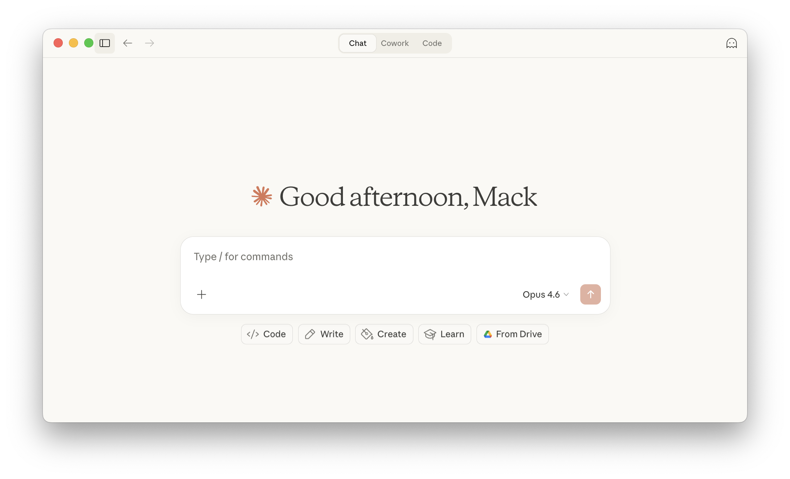
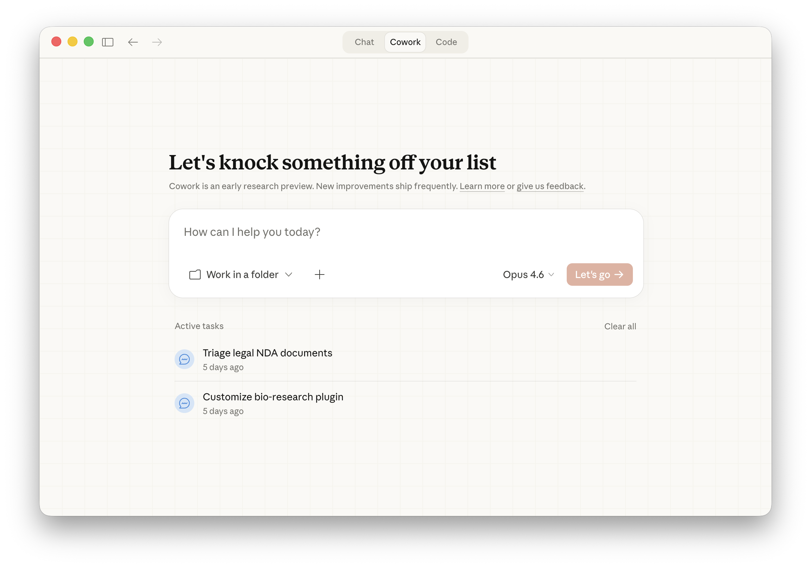
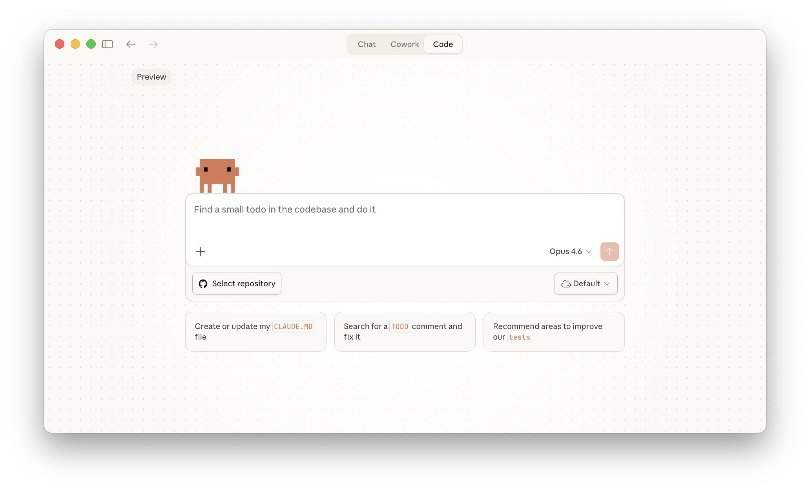

## 학습 목표

- Claude desktop app에서 일하는 세 가지 방식인 **Chat, Cowork, Code**를 구분하기
- quick entry, screenshot, scheduled tasks, subagents, local/cloud development 같은 핵심 기능 이해하기
- 작업을 시작하기 전에 **그 일이 어떤 모양인지** 보고 알맞은 모드를 고르기

## 한눈에 보는 흐름

<ol class="oa-flow">
  <li><strong>일의 모양 보기</strong>탭보다 일의 종류가 먼저</li>
  <li><strong>Chat</strong>주고받으며 함께 생각하기</li>
  <li><strong>Cowork</strong>일을 통째로 맡기기</li>
  <li><strong>Code</strong>코드베이스에서 소프트웨어 만들기</li>
</ol>

이 레슨을 한 문장으로 줄이면: **탭을 먼저 고르는 게 아니라, 눈앞의 일이 어떤 모양인지 알아보면 탭은 따라온다.**

## 1. 일의 세 가지 모양

<div class="oa-eli">
  <span class="oa-eli__head">🍽️ 쉽게 말하면</span>
  <p>요리 선생님과 <b>같이 만들며 배우는 것</b>(Chat), 케이터링 업체에 <b>"금요일 10인분 부탁해요" 하고 맡기는 것</b>(Cowork), 주방에 들어가 <b>설비를 직접 고치는 것</b>(Code)은 전혀 다른 일이에요. 같은 Claude지만 일의 모양에 따라 일하는 방식이 달라져요.</p>
</div>

Claude desktop app은 Claude와 일하는 home base예요. 회의 중 짧은 질문부터, 내가 다른 일을 하는 동안 Claude가 여섯 개 source로 조립하는 보고서까지 다뤄요. 일은 세 가지 모양으로 나뉘어요.

<div class="oa-cards">
  <div class="oa-card"><span class="oa-card__icon">💬</span><span class="oa-card__title">Chat — turn by turn</span>묻고, 답하고, 방향을 잡고, 고쳐요. 생각이 <b>주고받는 과정</b>에서 일어나요</div>
  <div class="oa-card oa-card--hl"><span class="oa-card__icon">📦</span><span class="oa-card__title">Cowork — 일 맡기기</span><b>결과</b>를 설명하면 Claude가 계획하고, 수행하고, 결과물을 들고 돌아와요</div>
  <div class="oa-card"><span class="oa-card__icon">⌨️</span><span class="oa-card__title">Code — 소프트웨어 만들기</span>코드베이스 안에서 직접 읽고, 코드를 쓰고 테스트하고, 명령을 실행해요</div>
</div>

```text
Chat   → 빠르고 대화적인 Claude
Cowork → 자료를 모으고 완성물을 만드는 Claude
Code   → 코드베이스 안에서 개발 작업을 수행하는 Claude
```

앞의 두 가지가 대부분의 지식 노동자가 하루를 보내는 곳이고, 세 번째는 개발자의 작업 공간이에요. 세 모드는 모두 같은 Claude intelligence를 기반으로 하고, Claude desktop app 안에 있어요.

Cowork와 Code는 내부적으로 Claude Code 기반의 agentic engine을 써요. 독립적인 작업을 이어 가며, sub-agent를 띄워 긴 작업을 처리할 수 있어요.

## 2. Chat — 주고받으며 함께 생각하기

<div class="oa-eli">
  <span class="oa-eli__head">🏓 쉽게 말하면</span>
  <p>탁구처럼 <b>공을 주고받는 일</b>이에요. 상대의 공을 봐야 내 다음 공이 정해지죠. 처음부터 전체 요청을 써 둘 수 없는 일, 매 턴마다 내 판단이 필요한 일이 Chat에 맞아요.</p>
</div>



Chat은 claude.ai에서 익숙한 Claude와 같아요. 덜 다듬어진 아이디어, 낯선 dashboard, 잘 안 읽히는 문단을 가져와서 한 턴씩 함께 풀어 가요.

### 이럴 때 Chat을 써요

| 신호 | 설명 |
|---|---|
| **답이 다음 질문을 바꿀 때** | 브레인스토밍처럼 답변마다 다음 질문이 열려요. 아직 몰랐으니 요청을 미리 다 쓸 수 없었던 일이에요 |
| **계속 그 안에 있고 싶을 때** | 초안 쓰기, 편집, 생각 정리처럼 끝의 완성물보다 **매 턴의 내 판단**이 핵심일 때 |
| **빠른 일일 때** | 질문 하나, 고쳐 쓰기 하나, "이게 무슨 뜻이야?"처럼 작업을 통째로 세팅하는 게 오히려 부담인 일 |

### Desktop app이라서 더해지는 기능

<div class="oa-cards">
  <div class="oa-card"><span class="oa-card__icon">⚡</span><span class="oa-card__title">Quick entry</span>Mac에서 Option 키를 두 번 누르면 지금 화면 위에 Claude가 떠요. 앱을 바꿔도 compact window가 위에 유지돼요</div>
  <div class="oa-card"><span class="oa-card__icon">📸</span><span class="oa-card__title">Screenshots · window sharing</span>화면을 캡처하거나 window를 공유해 Claude가 내가 보는 걸 직접 봐요. 말로 길게 설명하는 것보다 빠르고 정확해요 (Mac)</div>
  <div class="oa-card"><span class="oa-card__icon">🎙️</span><span class="oa-card__title">Dictation</span>타이핑 대신 말로 문제를 설명해요. 키보드에서 떨어져 있거나 말로 정리하는 게 빠를 때 좋아요 (Mac)</div>
  <div class="oa-card"><span class="oa-card__icon">🔌</span><span class="oa-card__title">Desktop connectors</span>로컬 도구와 서비스를 연결해 Claude가 내 컴퓨터의 것들과 함께 일해요</div>
</div>

### Chat이 적합한 상황

- **낯선 dashboard를 보고 있을 때**: screenshot을 찍고 "이 metric들이 무슨 뜻이야?"라고 물어요. dashboard는 그대로 보이고, "그럼 이 중에 진짜 신경 써야 할 건?"이 다음 턴이에요.
- **회의 사이에 발표 구조를 잡아야 할 때**: 음성으로 말하면 Claude가 outline을 쓰고, 3번 섹션에 이의를 제기하면 고쳐 줘요. 네 턴이면 끝나요.
- **메모 앱에 흩어진 아이디어를 정리할 때**: 몇 주간 Apple Notes에 적어 둔 launch 아이디어를 모으고, 반쯤 하다 만 것과 다른 연결 도구의 빈틈을 찾게 한 뒤 함께 채워요.
- 짧은 질문과 iterative drafting이 필요한 경우

Chat은 **짧고 빠른 대화형 협업**에 가장 적합해요.

## 3. Cowork — 일을 통째로 맡기기

<div class="oa-eli">
  <span class="oa-eli__head">🧳 쉽게 말하면</span>
  <p>여행을 갈 때 항공권, 숙소, 일정을 하나씩 직접 검색할 수도 있지만, 여행사에 <b>"3박 4일 제주, 예산 100만 원"</b>이라고 맡길 수도 있죠. 심부름 네 번이 지시 한 번이 돼요. 그래도 계획서는 내가 확인해요.</p>
</div>



Cowork는 실제로 시간이 걸리는 업무를 맡기기 위한 agentic tool이에요. 질문을 던지는 대신 **일 전체**(맥락 모으기, 분석하기, 완성물 만들기)를 넘기면 Claude가 끝내서 돌아와요. chat이 아니라 **delegation**이에요.

<div class="oa-vs">
  <div class="oa-vs__bad">
    <span class="oa-vs__label">💬 Chat으로 하면</span>
    <ul>
      <li>수치 뽑기, 비교, 요약 초안, 문서 서식을 <b>네 번의 심부름</b>으로 내가 이어 붙여요.</li>
      <li>업로드한 파일은 읽지만, 완성 파일은 <b>download</b>로 돌려줘요.</li>
    </ul>
  </div>
  <div class="oa-vs__good">
    <span class="oa-vs__label">📦 Cowork에 맡기면</span>
    <ul>
      <li>같은 일이 <b>지시 한 번</b>이에요.</li>
      <li>지정한 folder를 읽고, 완성물을 <b>같은 위치에 저장</b>해요.</li>
    </ul>
  </div>
</div>

### 이럴 때 일을 맡겨요

| 신호 | 설명 |
|---|---|
| **순서대로 하던 여러 단계가 있을 때** | 수치를 뽑고, 비교하고, 요약을 쓰고, 문서를 서식화하는 일 |
| **결과물이 내 file system에 놓일 완성 파일일 때** | 이름을 바꾼 파일 묶음, 알맞은 folder에 저장된 spreadsheet, 데스크톱의 서식 있는 PDF. (deck이나 doc 하나만 필요하면 맡길 필요 없어요. 유료 plan에서는 어느 대화에서든 artifact로 만들 수 있어요) |
| **일이 여러 도구에 걸쳐 있을 때** | 회의록은 한곳에, thread는 Slack에, 지난 분기 수치는 spreadsheet에 있는 경우. 금요일 roll-up을 scheduled task로 두면 Claude가 매번 세 곳을 직접 모아요 |
| **일정에 맞춰, 또는 내가 다른 일을 하는 동안 돌아가야 할 때** | 금요일의 shipped item review, 다음 회의를 준비해 주는 월요일 briefing |

Cowork에 잘 맞는 작업 예시예요.

- 여러 문서와 Slack, email을 읽고 research brief 작성
- 여러 source를 바탕으로 financial analysis 수행
- 계약서와 관련 문서를 검토하고 risk 정리
- 흩어진 자료를 바탕으로 slide deck 초안 작성

### 맡겨도 통제권은 내게 있어요

<ol class="oa-flow">
  <li><strong>확인 질문</strong>시작 전 scope · format · constraint를 짧게 질문</li>
  <li><strong>Plan 공유</strong>sidebar에서 계획을 보여 줘요</li>
  <li><strong>진행 확인</strong>보고 있는 source, 만들어지는 파일, 계획의 어느 단계인지</li>
  <li><strong>승인</strong>중요한 행동 전에는 멈추고 물어요</li>
</ol>

> 일을 맡긴다고 손을 떼는 건 아니에요. 진행 중 언제든 방향을 바꿀 수 있고, Claude가 **행동 전에 묻도록** 설정돼 있으면 이메일 발송이나 파일 공유 같은 중요한 행동에서 멈추고 승인을 받아요. **내 책상을 떠나는 것은 내가 통제해요.**

### Cowork의 기능

| 기능 | 무엇을 해 주나 |
|---|---|
| **Local folder access** | 컴퓨터의 folder를 지정하면 Claude가 그 안의 파일을 읽고, 관련 자료를 찾고, 완성된 결과를 같은 위치에 저장해요 |
| **Scheduled tasks** | 작업을 한 번 설정하면 정한 주기로 실행돼요. 예: 매일 아침 Slack과 calendar로 daily briefing, 매주 shipped item 요약, 아침 inbox triage |
| **Subagents** | 큰 작업을 하위 작업으로 나눠 병렬로 도는 background worker에게 맡겨요. 각자 자기 context를 갖고, Claude가 결과를 종합해 완성물 하나를 줘요 |
| **Projects** | 관련 작업을 전용 workspace로 묶어요. 각 project는 파일, instruction, memory를 가져요. Chat의 Projects와 비슷하지만 **실행하는 작업 중심**이에요 |
| **Browser use** | Claude in Chrome을 연결하면 웹사이트를 탐색하고 찾은 정보를 task로 가져와요. API가 없는 페이지의 데이터나 여러 사이트의 경쟁사 가격 확인에 유용해요 |
| **Computer use** | connector로 해결할 수 없을 때 Claude가 컴퓨터를 직접 조작해요(클릭, 타이핑, 앱 열기). 앱마다 접근 전에 permission을 묻고, blocklist로 접근 금지 대상을 지정할 수 있어요. Pro · Max plan에서 research preview예요 |
| **Plugins** | 특정 업무를 위해 미리 만들어진 skills · connectors · agents 묶음(sales, finance, legal 등). 그 역할이 일하는 방식대로 Claude가 일해요. `Customize → Plugins`에서 둘러보고 추가해요 |

> **Scheduled tasks는 어디서 실행되나요?** scheduled task는 **remote로 실행**돼서 컴퓨터가 잠들어 있거나 앱이 닫혀 있어도 돌아가요. 단, **내 컴퓨터의 파일이 필요한 task는 로컬에서**, 앱이 열려 있는 동안에만 실행돼요.

Computer use가 필요할 때 Claude는 보통 더 빠르고 안정적인 방법을 먼저 골라요.

<ol class="oa-flow">
  <li><strong>① Connectors</strong>가장 먼저</li>
  <li><strong>② Chrome</strong>connector가 없을 때</li>
  <li><strong>③ Screen interaction</strong>마지막 수단</li>
</ol>

Cowork는 **Pro, Max, Team, Enterprise** 사용자가 쓸 수 있고, 새 기능이 계속 추가돼요.

### 이전 버전 강의에 있던 항목

아래 두 항목은 이 노트를 처음 작성할 때 강의에 있던 내용이에요. 현재 강의 페이지 본문에는 설명이 없어서 따로 모아 둬요.

| 항목 | 내용 |
|---|---|
| **Dispatch** | 모바일 앱에서 desktop의 파일, connectors, plugins, desktop apps를 활용하는 Cowork 작업을 이어 갈 수 있는 persistent conversation thread. desktop과 mobile app이 모두 필요하고, 컴퓨터가 켜져 있으며 desktop app이 열려 있어야 해요 |
| **Protected environment** | Cowork는 컴퓨터 안의 제한된 공간에서 실행돼요. 공유한 folder 안에서는 파일을 읽고 만들고 수정할 수 있지만, 공유하지 않은 영역에는 접근할 수 없어요 |

### Cowork가 적합한 상황

- **모든 도구를 database처럼 조회하고 싶을 때**: "지난 분기 pricing에 대해 결정한 내용을 회의록, Slack, email에서 찾아 Q3 deck에 반영해줘." 맡기고, 하던 일을 하고, 결과를 확인해요.
- **50개 이상의 문서(계약서, 재무 자료, 회의 transcript)를 함께 검토해야 할 때**: 내 initiative와 가장 관련 있는 문서를 찾아 summary memo를 만들게 해요. 전부 읽어야만 보이는 pattern을 뽑아 줘요.
- **매주 월요일 아침 같은 일을 할 때**: 메시지 확인, status update 작성, 회의 준비를 scheduled task로 한 번 설정해 두고, 월요일을 잡무가 아닌 답으로 시작해요.
- 여러 웹사이트를 조사해 structured brief를 만들어야 할 때

Cowork는 **여러 source를 읽고 오래 걸리는 지식 작업을 완성물로 만드는 모드**예요.

## 4. Code — 소프트웨어 만들기

<div class="oa-eli">
  <span class="oa-eli__head">🔧 쉽게 말하면</span>
  <p>Cowork가 사무실에서 서류를 정리해 주는 동료라면, Code는 <b>기계실에 직접 들어가는 엔지니어</b>예요. 설비(코드)를 읽고, 고치고, 돌려 보고, 무엇을 바꿨는지 기록을 남겨요.</p>
</div>



Code 탭은 Claude Code의 기능을 desktop app 안에서 제공해요. 소프트웨어 개발을 위한 full development environment예요. Claude는 코드베이스 안에서 직접 일해요.

- 기존 코드 읽기
- 파일 작성과 수정
- 명령 실행, 테스트 실행
- **visual diff**로 변경 확인
- 내장 terminal에서 명령 output 확인
- **git**으로 모든 version 추적 (언제든 되돌릴 수 있어요)

Cowork가 공유된 folder 안의 제한된 workspace에서 동작한다면, Code는 project의 filesystem, terminal, development tools에 더 직접적으로 접근해요.

> 개발자가 아니라면 이것만 기억하세요: Code는 **별도의 탭**이고, 이 강의에서는 필요 없어요. 자세한 내용은 `Claude Code in Action` 강의에서 다뤄요.

### 어디서 실행할까 — Local과 Cloud

<div class="oa-vs">
  <div class="oa-vs__good">
    <span class="oa-vs__label">💻 Local</span>
    <ul>
      <li>내 컴퓨터의 folder를 선택하면 Claude가 그 파일을 직접 다뤄요.</li>
      <li>로컬 tool을 쓰고, 개발 서버를 실행하고, 브라우저에서 preview해요.</li>
      <li>로컬 환경이 필요한 프로젝트, 즉시 확인이 필요한 frontend 작업에 좋아요.</li>
    </ul>
  </div>
  <div class="oa-vs__good">
    <span class="oa-vs__label">☁️ Cloud</span>
    <ul>
      <li>GitHub repository를 연결하면 Claude가 cloud environment에서 일해요.</li>
      <li>앱을 닫아도 session이 계속돼서, 큰 refactor를 맡기고 나중에 확인할 수 있어요.</li>
      <li>큰 코드베이스, 또는 작업을 내 컴퓨터에서 분리하고 싶을 때 좋아요.</li>
    </ul>
  </div>
</div>

Cloud는 이전 버전 강의에서 **Remote**라고 불렀어요.

### Claude가 얼마나 스스로 할까

| 설정 | 동작 방식 | 이럴 때 |
|---|---|---|
| **Manually approve** | Claude가 모든 변경을 제안하고 승인을 기다려요 | 통제력이 가장 필요할 때 |
| **Accept edits** | 파일 편집을 자동으로 적용해요 | 구현 속도가 중요할 때 |
| **Plan** | 변경하기 전에 계획을 먼저 만들어요 | 큰 작업 전에 방향을 검토할 때 |

이전 버전 강의에서는 이 세 가지를 **Ask / Code / Plan**이라는 이름으로 소개했고, Code mode는 파일 변경은 자동 적용하되 terminal command 실행 전에는 확인한다고 설명했어요.

Code 탭은 **Pro, Max, Team, Enterprise** plan에서 쓸 수 있어요. 여러 project에 걸쳐 session을 여러 개 돌리고, sidebar에서 환경(Local · Cloud)과 상태로 걸러 볼 수 있어요.

## 5. 어떤 모드를 선택할까요?

<div class="oa-eli">
  <span class="oa-eli__head">🚦 쉽게 말하면</span>
  <p>편의점에 갈 땐 걷고, 이사할 땐 트럭을 부르고, 도로를 낼 땐 중장비를 써요. <b>일의 크기와 종류</b>를 보면 탈것은 저절로 정해져요.</p>
</div>

| 하려는 일 | 일의 모양 | 지금 있는 곳 |
|---|---|---|
| 묻고, 브레인스토밍하고, 초안을 쓰고, 한 턴씩 생각을 풀어 가기 | turn by turn으로 함께 일하기 | **Chat** (quick entry, dictation, screenshots) |
| 완성된 deliverable로 끝나거나, 여러 도구에 걸치거나, 일정에 맞춰 도는 다단계 작업 맡기기 | 일 맡기기 | **Cowork** (folder access, connectors, scheduled tasks, subagents) |
| 코드베이스에서 코드를 쓰고, 테스트하고, 실행하고, 배포하기 | 소프트웨어 만들기 | **Code 탭** (Local 또는 Cloud) |

### 세 모드 비교

| 구분 | Chat | Cowork | Code |
|---|---|---|---|
| 최적화된 작업 | 빠른 대화, 아이디어 탐색, 초안 작성, 학습 | 복잡하고 지속적인 research, analysis, 파일 정리, 완성 문서 제작 | 소프트웨어 개발, 테스트, 실행, 배포 |
| 주요 기능 | Quick entry, dictation, screenshots | 로컬 folder, plugins, subagents, scheduled tasks | 자율성 설정(Manually approve / Accept edits / Plan), visual diffs, git integration, Local/Cloud environment |
| 확장 | Connectors, Skills, Claude in Chrome | Connectors, Skills, Claude in Chrome, Plugins, Computer Use | Connectors, Skills, Claude in Chrome, Plugins, Hooks |

업무의 복잡도와 필요한 권한도 함께 봐요.

- 화면 하나를 보고 질문하는 수준이면 → **Chat**
- 여러 tool과 파일을 연결해 긴 작업을 맡기려면 → **Cowork**
- terminal, git, code diff가 필요하면 → **Code**

### 실습 질문

- 이번 주에 Claude를 어떻게 썼나요? 어떤 요청이 turn-by-turn 생각이었고, 어떤 요청이 사실은 **통째로 맡길 작업인데 습관 때문에 질문 하나씩 넣은 것**이었나요?
- 가장 덜어 내고 싶은 작업을 떠올려 보세요. 여러 단계인가요? 내 컴퓨터에 파일을 저장하고 정리해야 하나요? 여러 도구에 걸쳐 있나요? 하나라도 그렇다면 맡길 일이에요. **첫 질문이 아니라 원하는 결과**를 적어 보세요.
- 최근 여러 source에서 정보를 모아야 했던 프로젝트를 Cowork에 맡겼다면 workflow가 어떻게 달라졌을까요?
- 개발 작업에서 Manually approve, Accept edits, Plan 중 어떤 설정이 가장 편할까요?

## 확인 문제

<details class="oa-quiz">
  <summary>Q1. 낯선 dashboard를 보다가 "이 metric이 무슨 뜻이지?" 궁금해졌어요. 어떤 모드가 맞나요?</summary>
  <p><b>정답: Chat.</b> 빠르고, 답을 보고 다음 질문이 정해지는 turn-by-turn 작업이에요. screenshot을 찍어 보여 주면 설명이 더 빨라요.</p>
</details>

<details class="oa-quiz">
  <summary>Q2. 매주 월요일 아침 Slack, email, calendar를 확인해 status update를 만드는 일을 자동화하고 싶어요. 어떤 모드의 어떤 기능인가요?</summary>
  <p><b>정답: Cowork의 scheduled tasks.</b> 여러 도구에 걸쳐 있고 일정에 맞춰 반복되는 다단계 작업이라 맡기는 모양이에요.</p>
</details>

<details class="oa-quiz">
  <summary>Q3. Chat과 Cowork가 완성 파일을 다루는 방식은 어떻게 다른가요?</summary>
  <p><b>정답: Chat은 업로드한 파일을 읽고 완성 파일을 download로 돌려줘요. Cowork는 지정한 folder를 읽고 완성물을 같은 folder에 저장해요.</b> 강의가 꼽는 가장 구체적인 차이예요.</p>
</details>

<details class="oa-quiz">
  <summary>Q4. Code 탭에서 큰 refactor를 맡기고 앱을 닫은 뒤 나중에 확인하고 싶어요. Local과 Cloud 중 무엇을 고르나요?</summary>
  <p><b>정답: Cloud.</b> GitHub repository를 연결하면 cloud environment에서 일하고, 앱을 닫아도 session이 계속돼요. Local은 내 컴퓨터의 folder와 로컬 tool을 직접 쓸 때 골라요.</p>
</details>

## 정리

- Desktop app의 일은 세 모양이에요: **주고받기(Chat) · 맡기기(Cowork) · 소프트웨어 만들기(Code)**.
- **Chat**은 답이 다음 질문을 바꾸는 빠른 대화형 협업에 맞아요. quick entry, screenshot, dictation이 더해져요.
- **Cowork**는 여러 단계 · 여러 도구 · 일정이 걸린 일을 완성물로 만들어요. folder access, scheduled tasks, subagents가 핵심이에요.
- 맡겨도 통제권은 내게 있어요. Claude는 plan을 보여 주고, 중요한 행동 전에 승인을 구해요.
- **Code**는 코드베이스 안에서 일하고, Local/Cloud와 자율성 설정(Manually approve / Accept edits / Plan)을 골라요.
- 선택 기준: **"Claude가 얼마나 오래, 얼마나 많은 도구와 context를 써야 하는가?"** 짧은 대화는 Chat, 긴 지식 작업은 Cowork, 소프트웨어 개발은 Code예요.

다음 모듈에서는 Projects로 작업과 지식을 구조화하는 방법을 다뤄요.
