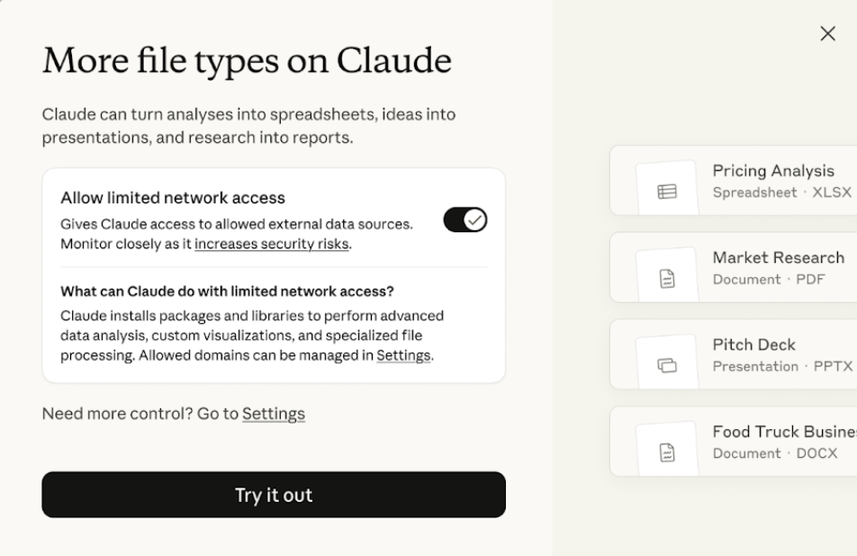

## 학습 목표

- **Skills**가 무엇이고 Claude가 어떻게 사용하는지 이해하기
- Anthropic의 **built-in Skills**와 **custom Skills**를 구분하기
- Settings에서 Skills를 활성화하고 관리하는 방법 익히기
- **Projects와 Skills의 차이**를 이해하고 함께 쓰는 방법 정리하기

## 한눈에 보는 흐름

<ol class="oa-flow">
  <li><strong>반복 업무 방식</strong>우리만의 절차와 기준</li>
  <li><strong>Skill로 패키징</strong>instruction · script · resource</li>
  <li><strong>자동 사용</strong>관련 작업에서 Claude가 알아서 호출</li>
  <li><strong>일관된 결과</strong>매번 같은 절차, 같은 품질</li>
</ol>

이 레슨을 한 문장으로 줄이면: **Projects는 지식을 저장하고, Skills는 일을 수행한다.**

## 1. Skills란?

<div class="oa-eli">
  <span class="oa-eli__head">📖 쉽게 말하면</span>
  <p>맛집 주방에는 <b>레시피 카드</b>가 있어요. 새 요리사가 와도 카드대로 만들면 같은 맛이 나죠. Skill은 Claude에게 건네는 레시피 카드예요. 매번 말로 설명하지 않아도, 그 요리를 주문받으면 Claude가 알아서 카드를 꺼내요.</p>
</div>

**Skills**는 Claude가 특정 작업을 더 잘 수행하도록 **동적으로 불러오는** instruction, script, resource의 folder예요. 특정 작업을 반복 가능한 방식으로 해내도록 가르치는 **expertise package**라고 생각하면 돼요.

Claude로 Excel spreadsheet, PowerPoint presentation, Word document, PDF를 만들어 본 적이 있다면 이미 Skills를 써 본 거예요. 이런 file creation 기능은 뒤에서 Skills가 작동해서 가능해요.

### Skills가 해결하는 문제

반복 업무에는 보통 "우리만의 방식"이 있어요.

- 분기별 variance analysis를 어떤 순서로 진행할지
- brand voice review에서 무엇을 확인할지
- compliance checklist를 어떤 기준으로 적용할지
- 회의록을 어떤 template으로 정리할지

<div class="oa-vs">
  <div class="oa-vs__bad">
    <span class="oa-vs__label">❌ 매번 prompt로 설명</span>
    <ul>
      <li>같은 절차를 길게 다시 적어요.</li>
      <li>번거롭고 일관성이 떨어져요.</li>
    </ul>
  </div>
  <div class="oa-vs__good">
    <span class="oa-vs__label">✅ Skill로 고정</span>
    <ul>
      <li>절차와 기준을 Skill 안에 넣어 둬요.</li>
      <li>Claude가 관련 작업에서 자동으로 써서 <b>매번 같은 엄격한 단계</b>를 따라요.</li>
    </ul>
  </div>
</div>

```text
반복 업무 방식
  ↓
Skill로 패키징
  ↓
Claude가 관련 작업에서 자동 사용
  ↓
일관된 절차와 결과
```

## 2. Skill의 두 가지 유형

<div class="oa-eli">
  <span class="oa-eli__head">🍱 쉽게 말하면</span>
  <p>편의점 도시락(<b>Anthropic Skills</b>)은 이미 만들어져 있어서 바로 먹으면 돼요. 집밥 레시피(<b>Custom Skills</b>)는 우리 집 입맛에 맞게 직접 적어 둔 거예요.</p>
</div>

<div class="oa-cards">
  <div class="oa-card"><span class="oa-card__icon">🏢</span><span class="oa-card__title">Anthropic Skills</span>Anthropic이 만들고 유지관리해요. Excel, Word, PowerPoint, PDF 파일 생성과 편집을 강화하는 built-in Skills</div>
  <div class="oa-card oa-card--hl"><span class="oa-card__icon">🧑‍🔧</span><span class="oa-card__title">Custom Skills</span>나나 조직이 직접 만들어요. 특정 domain이나 반복 workflow를 Claude에게 가르쳐요</div>
</div>

### Anthropic Skills

관련 요청을 하면 Claude가 **자동으로 호출**해요. 쓰려고 따로 할 일은 없어요.

```text
월별 지출을 추적하는 Excel spreadsheet를 만들어줘. 총합 공식도 포함해줘.
```

```text
이 회의록 문서를 PowerPoint presentation으로 바꿔줘.
```

```text
이 데이터를 요약한 PDF report를 만들어줘.
```

### Custom Skills

| 예시 Skill | 하는 일 |
|---|---|
| Brand guideline Skill | 회사 brand guideline을 presentation에 적용 |
| 회의록 Skill | 회의록을 사내 template에 맞춰 정리 |
| Data analysis Skill | 조직의 data analysis workflow 실행 |
| 법무 검토 Skill | 법무 검토 checklist 적용 |

Custom Skill의 강점은 Claude가 일반적인 답변이 아니라 **우리 조직의 방식**을 따르게 만든다는 점이에요.

## 3. Skills 활성화하고 사용하기

<div class="oa-eli">
  <span class="oa-eli__head">🔌 쉽게 말하면</span>
  <p>가전제품은 <b>차단기가 올라가 있어야</b> 켜져요. Skills의 차단기는 "Code execution and file creation"이에요. 이게 켜져 있어야 개별 Skill 스위치가 의미가 있어요.</p>
</div>

Skills는 **모든 plan**에서 쓸 수 있어요. 다만 **Code execution and file creation**이 켜져 있어야 해요. Skills는 Claude의 secure sandboxed computing environment에서 동작하기 때문이에요.

<ol class="oa-flow">
  <li><strong>Settings 열기</strong><code>Settings &gt; Capabilities</code>로 이동</li>
  <li><strong>실행 환경 확인</strong><code>Code execution and file creation</code>이 켜져 있는지</li>
  <li><strong>Skills 섹션</strong>아래로 스크롤</li>
  <li><strong>개별 토글</strong>필요한 Skill을 켜거나 끄기</li>
</ol>

켜고 나면 Settings에 Anthropic의 built-in Skills와 내가 올린 custom Skills가 함께 나열돼요.

| Plan | 조직 수준 설정 |
|---|---|
| **Enterprise** | 조직 Owner가 Admin settings에서 **Code execution과 Skills를 모두** 먼저 활성화해야 individual members가 접근할 수 있어요 |
| **Team** | 조직 수준에서 기본으로 활성화되어 있어요 |

### 실제로 Skills가 쓰이는 방식

Skills의 장점은 보통 **Skill을 직접 고르지 않아도 된다**는 점이에요. Claude가 요청을 보고 관련 Skill을 자동으로 선택해요. 예를 들어 다음 요청은 document creation Skills를 호출할 수 있어요.

```text
월별 expense tracking용 Excel 파일을 만들어줘. category별 합계 공식도 넣어줘.
```

```text
이 meeting notes를 PowerPoint presentation으로 바꿔줘.
```

```text
이 데이터를 요약한 PDF report를 생성해줘.
```

```text
scenario analysis가 포함된 financial model을 Excel로 만들어줘.
```

- Claude가 Skill을 쓰면 작업 중 **chain of thought** 영역에 Skill 사용이 언급돼요.
- 결과물은 **다운로드 가능한 파일**로 제공되고, Google Drive에 바로 저장할 수도 있어요.

> Claude Slides와 Claude Docs가 켜진 유료 plan에서는 deck이나 문서를 요청하면 파일 대신 **artifact**가 만들어질 수 있어요. Claude와 계속 작업한 뒤 다 되면 export하는 방식이에요.

### File execution

Skills 덕분에 Claude는 slides, spreadsheets, contract redlines 같은 **실제 파일**을 제한된 환경 안에서 다룰 수 있어요.

<ol class="oa-flow">
  <li><strong>업로드</strong><code>.xlsx</code> · <code>.pptx</code> · <code>.docx</code> · <code>.pdf</code></li>
  <li><strong>Claude가 작업</strong>slide 생성, 분석, 수정 제안</li>
  <li><strong>새 버전 받기</strong>download 또는 Drive에서 열기</li>
</ol>

> Chat에서 파일을 업로드하면 Claude는 **원본을 직접 덮어쓰지 않고 새 버전의 문서를 만들어요.**

외부 데이터 접근이 필요한 경우 제한적 네트워크 접근을 허용하라는 prompt가 표시돼요. 안내가 나오면 `Allow limited network access`를 켜면 돼요.



## 4. 보안 고려사항

<div class="oa-eli">
  <span class="oa-eli__head">💾 쉽게 말하면</span>
  <p>길에서 주운 USB를 회사 컴퓨터에 바로 꽂지 않잖아요. Skill도 <b>실행되는 코드</b>를 담을 수 있으니, 어디서 왔는지와 안에 뭐가 들었는지 먼저 확인해야 해요.</p>
</div>

Skills는 executable code를 포함할 수 있어서 신중하게 써야 해요.

<div class="oa-cards">
  <div class="oa-card oa-card--warn"><span class="oa-card__icon">⚠️</span><span class="oa-card__title">신뢰할 수 있는 source만</span>Custom Skills는 신뢰할 수 있는 source에서만 설치해요</div>
  <div class="oa-card oa-card--warn"><span class="oa-card__icon">🔍</span><span class="oa-card__title">사용 전 검토</span>외부에서 받은 Custom Skill은 내용을 검토해 무엇을 하는지 이해해요</div>
  <div class="oa-card"><span class="oa-card__icon">✅</span><span class="oa-card__title">Built-in은 검증됨</span>Anthropic built-in Skills는 Anthropic이 테스트하고 유지관리해요</div>
  <div class="oa-card"><span class="oa-card__icon">🔒</span><span class="oa-card__title">업로드는 private</span>직접 업로드한 Custom Skills는 개인 계정에 private하게 저장돼요</div>
</div>

> Skills는 강력한 자동화 단위예요. 편의성만큼 **검토와 신뢰**도 중요해요.

## 5. Custom Skill 만들기

<div class="oa-eli">
  <span class="oa-eli__head">🎤 쉽게 말하면</span>
  <p>후임에게 인수인계할 때 문서를 처음부터 혼자 쓰는 대신, <b>후임이 질문하고 내가 답하면 후임이 매뉴얼로 정리</b>해 주는 방식이에요. 코드를 쓸 필요가 없어요.</p>
</div>

Built-in Skills가 흔한 문서 생성 작업을 다룬다면, Skills의 진짜 힘은 직접 만들 때 나와요. 가장 쉬운 방법은 **Claude와 대화하면서** 만드는 거예요. 코드를 쓰거나 파일을 수동으로 만들 필요 없이 Claude가 기술적인 구조를 처리해요.

<ol class="oa-flow">
  <li><strong>① 설명하기</strong>새 chat에서 만들고 싶은 Skill 말하기</li>
  <li><strong>② 질문에 답하기</strong>Claude가 workflow를 인터뷰해요</li>
  <li><strong>③ 자료 올리기</strong>template · style guide · brand asset</li>
  <li><strong>④ 저장하기</strong>생성된 Skill 파일 저장</li>
</ol>

| 단계 | 자세히 |
|---|---|
| **① 설명하기** | 새 chat을 시작하고 만들고 싶은 Skill을 설명해요 |
| **② 질문에 답하기** | Claude가 workflow를 이해하려고 질문해요: 이 Skill이 무엇을 해야 하나? 좋은 결과물의 기준은? 언제 쓰는지 예시는? |
| **③ 자료 올리기** | template, style guide, brand asset, 자랑스러운 작업 예시 같은 참고 자료를 업로드하면 Claude가 원하는 걸 정확히 이해해요 |
| **④ 저장하기** | Claude가 제대로 구조화된 Skill 파일을 생성해요. 저장하면 바로 Skill로 쓸 수 있어요 |

예시 prompt:

```text
분기별 비즈니스 리뷰를 작성하는 Skill을 만들고 싶어.
```

```text
우리 회사 brand guideline을 presentation에 적용하는 Skill이 필요해.
```

- **확인하기**: 만든 Skill은 left sidebar의 `Customize` 탭에서 볼 수 있어요. 내 Skills 목록에 Anthropic built-in Skills와 나란히 나타나요.
- **자동 호출**: 그때부터 관련 작업을 하면 Claude가 자동으로 호출해요. 수동으로 실행할 필요가 없어요.
- **개선하기**: 수동으로 내용을 편집하거나, Claude에게 Skill 수정을 요청하면 파일을 업데이트해 줘요.

## 6. Skills vs Projects

<div class="oa-eli">
  <span class="oa-eli__head">📚 쉽게 말하면</span>
  <p>Project는 <b>자료실</b>이고 Skill은 <b>작업 매뉴얼</b>이에요. 자료실에는 "무엇을 알아야 하는지"가, 매뉴얼에는 "어떻게 해야 하는지"가 있어요. 매뉴얼을 따르다가 자료실 서류를 꺼내 볼 수 있죠.</p>
</div>

둘 다 Claude에게 더 많은 context를 주지만 목적이 달라요.

```text
Projects store knowledge.
Skills perform tasks.
```

<div class="oa-vs">
  <div class="oa-vs__good">
    <span class="oa-vs__label">📚 Projects — knowledge hub</span>
    <ul>
      <li><b>"무엇을 알아야 하는가"</b></li>
      <li>Claude가 내 업무를 이해하는 데 필요한 참고 자료를 담아요: project spec, 회의록, research 문서.</li>
      <li>project 안의 모든 대화에서 그 정보를 활용해요.</li>
    </ul>
  </div>
  <div class="oa-vs__good">
    <span class="oa-vs__label">⚙️ Skills — procedural machine</span>
    <ul>
      <li><b>"어떻게 해야 하는가"</b></li>
      <li>작업을 어떻게 실행할지 담아요: 구체적인 단계, 순서, methodology.</li>
      <li>일관되게 돌리고 싶은 반복 workflow에서 빛나요.</li>
    </ul>
  </div>
</div>

| 구분 | Projects | Skills |
|---|---|---|
| **목적** | Claude가 참조할 지식 저장 | Claude가 실행할 절차 정의 |
| **적합한 경우** | 장기 context, reference material, team collaboration | 반복 workflow, multi-step task, 일관된 methodology |
| **예시** | 고객 hub, research workspace, feedback generator | brand/legal 같은 process guideline, blog drafting, PDF creation |
| **지속성** | project 안의 모든 chat에서 knowledge 사용 | Skill이 호출될 때 instruction 적용 |

### 함께 쓰기

둘은 서로를 보완해요. Skill은 project에 저장된 지식을 참조할 수 있어요. 예를 들어 `customer call prep` Skill은 project knowledge base에 올려 둔 고객 profile을 가져와 call 준비 workflow를 실행해요.

```text
Project = 고객 정보와 과거 자료
Skill = 고객 미팅 준비 절차
```

Project가 **what**(정보)을, Skill이 **how**(절차)를 제공해요.

### 실습 질문

- 내가 정기적으로 만드는 문서 중 Claude built-in Skills가 도움이 될 만한 것은 무엇인가요?
- 반복되는 업무 절차 중 custom Skill로 만들면 좋은 것은 무엇인가요?
- 문서 생성이나 데이터 분석 업무에서 매번 설명하는 규칙은 무엇인가요?
- Projects와 Skills를 함께 쓰면 더 좋아질 workflow는 무엇인가요?

## 확인 문제

<details class="oa-quiz">
  <summary>Q1. Skills를 쓰려면 Settings에서 무엇이 먼저 켜져 있어야 하나요?</summary>
  <p><b>정답: Code execution and file creation.</b> Skills는 Claude의 secure sandboxed computing environment에서 동작하기 때문이에요. <code>Settings &gt; Capabilities</code>에서 확인해요.</p>
</details>

<details class="oa-quiz">
  <summary>Q2. "이 회의록을 PowerPoint로 바꿔줘"라고 할 때, 사용할 Skill을 내가 직접 골라야 하나요?</summary>
  <p><b>정답: 아니요.</b> Claude가 요청을 보고 관련 Skill을 자동으로 선택해요. 사용 여부는 chain of thought 영역에서 확인할 수 있어요.</p>
</details>

<details class="oa-quiz">
  <summary>Q3. 인터넷에서 받은 custom Skill을 설치하려고 해요. 먼저 무엇을 해야 하나요?</summary>
  <p><b>정답: 신뢰할 수 있는 source인지 확인하고, 내용을 검토해 무엇을 하는지 이해해요.</b> Skills는 executable code를 포함할 수 있기 때문이에요.</p>
</details>

<details class="oa-quiz">
  <summary>Q4. 짝 맞추기 — Projects와 Skills 중 어디에 둘까요?</summary>
  <p>"고객 profile과 과거 커뮤니케이션 이력" → <b>Project</b> (참조할 지식)<br>"고객 call 전에 항상 따르는 준비 절차" → <b>Skill</b> (실행할 절차)<br>"회사 brand guideline을 presentation에 적용하는 방법" → <b>Skill</b><br>"팀이 함께 보는 research 자료 모음" → <b>Project</b></p>
</details>

## 정리

- Skills는 Claude에게 **반복 가능한 전문 workflow**를 가르치는 instruction · script · resource 패키지예요.
- **Anthropic Skills**는 Excel · Word · PowerPoint · PDF 같은 문서 생성과 파일 작업을 맡고, **Custom Skills**는 개인이나 조직의 workflow를 가르쳐요.
- `Code execution and file creation`이 켜져 있어야 하고, 관련 요청에서 Claude가 Skill을 **자동으로 선택**해요.
- executable code를 포함할 수 있으니 **신뢰할 수 있는 source와 내용 검토**가 중요해요.
- Custom Skill은 코드 없이 **Claude와 대화하면서** 만들고, `Customize` 탭에서 확인하고 개선해요.
- **Projects는 지식을 저장하고, Skills는 절차를 실행해요.** 둘은 함께 쓸 수 있어요.

다음 레슨부터는 connectors로 Claude의 reach를 확장하는 방법을 살펴봐요.
