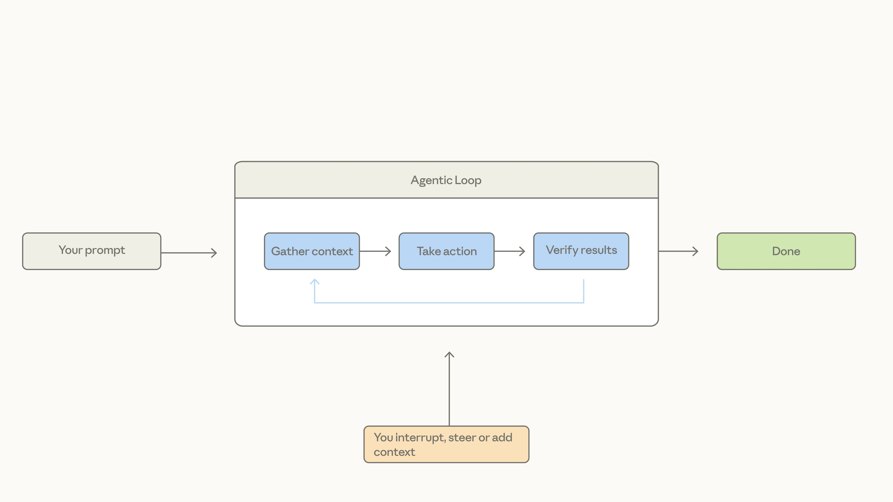

## 학습 목표

- **agentic loop**의 단계를 순서대로 설명하기
- **context window · tools · permissions**가 Claude Code에서 맡는 역할 파악하기
- **permission mode 네 가지**(Manual · Auto-accept · Plan mode · Auto mode)를 구분하기
- Claude Code가 일반 chat 앱과 근본적으로 다른 이유 설명하기

## 한눈에 보는 흐름

<ol class="oa-flow">
  <li><strong>agentic loop</strong>맥락 수집 → 행동 → 검증을 될 때까지 반복</li>
  <li><strong>Context</strong>유한한 작업 기억, 차면 자동 compact</li>
  <li><strong>Tools</strong>텍스트만이 아니라 행동하게 해 주는 근간</li>
  <li><strong>Permissions</strong>얼마나 맡길지 정하는 네 가지 모드</li>
</ol>

이 레슨을 한 문장으로 줄이면: **Claude Code는 "읽고 → 행동하고 → 스스로 검증하는" loop를 돌기 때문에 chat 창과 근본적으로 달라요.**

## 1. agentic loop

  🍳 쉽게 말하면
  
요리사는 재료를 확인하고, 조리하고, <b>맛을 본 뒤</b> 싱거우면 간을 다시 해요. 맛이 맞을 때까지 반복하죠. Claude Code도 한 번 답하고 끝나는 게 아니라 결과를 확인하며 돌아요.

Claude Code는 일반적인 chat 애플리케이션과 달라요. 내부 동작을 이해하면 더 효과적으로 쓸 수 있고, 그 핵심이 **agentic loop**예요.

<ol class="oa-flow">
  <li><strong>prompt 입력</strong>사용자가 Claude Code에 prompt를 입력해요</li>
  <li><strong>맥락 수집</strong>모델과 상호작용하며 필요한 맥락을 모아요. 모델은 텍스트 또는 실행할 수 있는 tool call을 돌려줘요</li>
  <li><strong>행동</strong>예: 파일 수정, 명령 실행</li>
  <li><strong>검증</strong>결과가 prompt의 목표를 달성했는지 판단해요</li>
  <li><strong>종료 또는 반복</strong>달성했으면 다음 prompt를 기다리고, 아니면 다시 돌아요</li>
</ol>

| 검증 결과 | 다음 동작 |
|---|---|
| 목표를 달성했어요 | 종료하고 다음 prompt를 기다려요 |
| 아직 아니에요 | 결과가 **완성되고 검증 가능할 때까지** loop를 반복해요 |

> 이 loop 내내 사용자는 **맥락을 추가하거나, 중단하거나, 방향을 조정**해 목표로 이끌 수 있어요.

## 2. Context

  🗄️ 쉽게 말하면
  
책상 위 공간과 같아요. 서류를 계속 펼치다 보면 자리가 모자라요. 그러면 <b>덜 중요한 건 치우고 요점만 메모로 남겨서</b> 다시 일할 자리를 만들어요. 이게 compact예요.

Claude에는 **context window**가 있어요. 대화, 파일 내용, 명령 출력 등을 **얼마나 저장하고 참조할 수 있는지**를 결정해요.

한계에 도달하면 Claude Code가 대화를 **compact**해요. 제거하거나 요약할 수 있는 부분을 **자동으로** 정해서, context window를 다시 쓸 수 있는 크기로 줄여요.

## 3. Tools

  🧰 쉽게 말하면
  
말로만 조언하는 사람과, 공구함을 들고 와서 직접 고치는 사람의 차이예요. tool은 Claude의 <b>손과 공구</b>예요.

**Tools**는 agent가 동작하는 근간(backbone)이에요.

  

    💬 대부분의 AI assistant
    <ul>
      <li>텍스트를 받아 텍스트를 내보낼 뿐이에요</li>
    </ul>
  

  

    🛠️ tool이 있는 Claude Code
    <ul>
      <li>작업을 진전시키기 위해 <b>언제 코드를 실행할지</b> 스스로 결정해요</li>
      <li>파일 읽기 tool, 웹 검색 tool 등 무엇이든 될 수 있어요</li>
    </ul>
  

Claude Code는 **의미 이해(semantic understanding)**를 바탕으로 언제 tool을 호출하고, 그 출력을 어떻게 쓸지 판단해요.

## 4. Permissions

  🔑 쉽게 말하면
  
집을 봐 주는 사람에게 열쇠를 맡기는 것과 같아요. <b>매번 전화로 물어보게</b> 할 수도 있고, 청소 정도는 알아서 하게 할 수도 있고, 둘러보고 계획만 써 오게 할 수도 있어요.

Claude Code에는 여러 permission mode가 있어요.

| 모드 | 파일 수정 | 명령 실행 | 특징 |
|---|---|---|---|
| **Manual** | 매번 허가 요청 | 매번 허가 요청 | 파일을 수정하거나 shell 명령을 실행하기 전에 **명시적으로** 물어봐요 |
| **Auto-accept** | 묻지 않고 수정 | `mkdir`, `mv`, `rm` 같은 흔한 파일시스템 명령은 묻지 않고 실행. **그 외 명령은 여전히 승인 필요** | 편집은 맡기고 명령만 챙기고 싶을 때 |
| **Plan mode** | 소스 파일은 수정하지 않음 | 탐색을 위해 파일을 읽고 shell 명령을 실행 | 작업을 시작하기 전에 **행동 계획**을 정리해요 |
| **Auto mode** | 일상적인 permission prompt 없이 진행 | 일상적인 permission prompt 없이 진행 | classifier가 백그라운드에서 대부분의 행동을 확인해, **되돌릴 수 없거나, 파괴적이거나, 내 환경 밖을 향하는** 행동을 막아요 |

Auto mode에서 무언가 막히면 Claude는 보통 **더 안전한 방법을 찾거나** 진행해도 되는지 사용자에게 물어봐요.

- 새 세션이 **어떤 모드로 시작하는지**는 Claude Code 버전과 설정에 따라 달라요.
- 이 모든 것은 **settings 파일**에서 구성할 수 있어요.

> 권한을 건너뛸 때는 주의하세요. Claude Code에 명령 실행의 전권을 주면, 실수가 **일어나기 전에** 잡아내기가 더 어려워져요.

### 예전 노트와 달라진 점

| 항목 | 예전 설명 | 현재 강의 본문 |
|---|---|---|
| 기본 모드 이름 | "기본 동작" | **Manual** |
| Auto-accept | 파일만 자동, 명령은 모두 승인 | 파일 + `mkdir`·`mv`·`rm` 같은 흔한 파일시스템 명령까지 자동 |
| Plan mode | 읽기 전용 도구만 사용 | 파일을 읽고 **shell 명령도 실행**하되 소스 파일은 수정하지 않음 |
| Auto mode | 없음 | 새로 추가 |

## 확인 문제

  
Q1. agentic loop에서 검증 결과가 목표에 못 미치면 어떻게 되나요?

  
<b>정답: 결과가 완성되고 검증 가능할 때까지 loop를 다시 돌아요.</b> 달성했을 때만 종료하고 다음 prompt를 기다려요.

  
Q2. context window가 한계에 도달하면 Claude Code는 무엇을 하나요?

  
<b>정답: 대화를 compact해요.</b> 제거하거나 요약할 부분을 자동으로 정해 context를 다시 쓸 수 있는 크기로 줄여요.

  
Q3. Auto-accept 모드에서 <code>npm test</code> 같은 일반 명령은 자동으로 실행되나요?

  
<b>정답: 아니요.</b> 파일 수정과 <code>mkdir</code>, <code>mv</code>, <code>rm</code> 같은 흔한 파일시스템 명령만 자동이고, 그 외 명령은 여전히 승인이 필요해요.

  
Q4. Auto mode의 classifier는 어떤 행동을 막는 데 초점을 두나요?

  
<b>정답: 되돌릴 수 없거나(irreversible), 파괴적이거나(destructive), 내 환경 밖을 향하는 행동.</b> 막히면 Claude가 더 안전한 방법을 찾거나 사용자에게 물어봐요.

## 정리

- Claude Code는 **agentic loop, 관리되는 context window, tools, 구성 가능한 permissions**를 터미널 안에서 결합해요.
- loop는 **맥락 수집 → 행동 → 검증**이고, 사용자는 언제든 개입할 수 있어요.
- context가 차면 **자동 compact**로 공간을 되찾아요.
- **tools** 덕분에 텍스트만 주고받는 assistant와 달리 실제로 행동해요.
- permission mode는 **Manual · Auto-accept · Plan mode · Auto mode**이고, 권한을 건너뛸수록 실수를 미리 잡기 어려워요.
- 코드베이스를 읽고, 행동하고, **스스로 결과를 검증**한다는 점이 chat 창과 근본적으로 다른 부분이에요.
