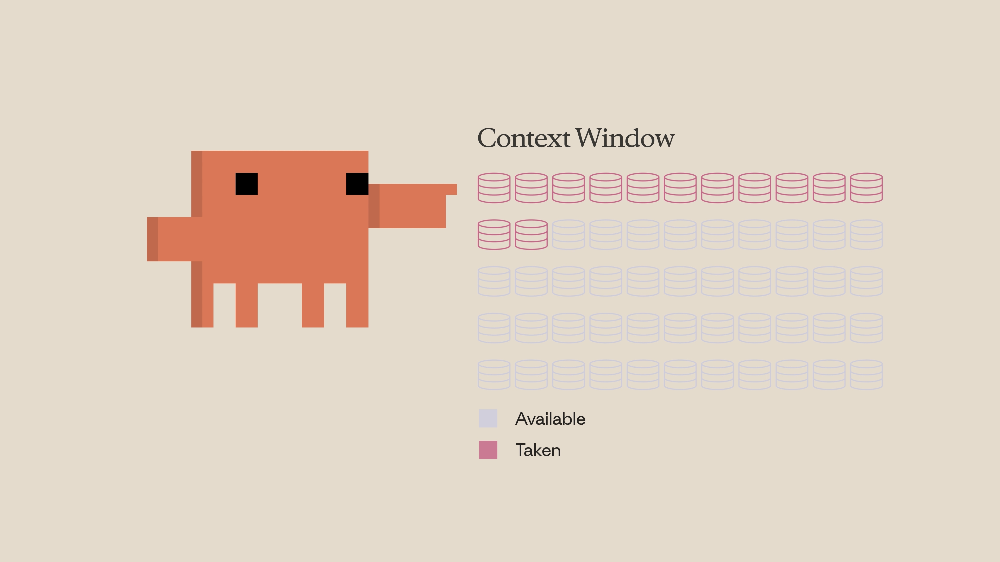

## 학습 목표

- **context window**가 무엇이고 무엇이 그 공간을 차지하는지 이해하기
- **compaction**과 `/compact`, `/clear`, `/context` 명령의 차이 파악하기
- 상황에 따라 `/compact`와 `/clear` 중 **무엇을 쓸지** 판단하기
- context 공간을 아끼는 **실전 습관 세 가지** 익히기

## 한눈에 보는 흐름

<ol class="oa-flow">
  <li><strong>context는 작업 기억</strong>파일 · 명령 · 메시지가 모두 공간을 차지</li>
  <li><strong>차면 자동 compact</strong>요약하고 덜어 내지만 세부를 잃을 수 있어요</li>
  <li><strong>명령으로 직접 관리</strong><code>/compact</code> · <code>/clear</code> · <code>/context</code></li>
  <li><strong>아끼는 습관</strong>구체적인 prompt · MCP 서버 정리 · subagent</li>
</ol>

이 레슨을 한 문장으로 줄이면: **context는 유한하니, 이어 갈 땐 `/compact`, 새로 시작할 땐 `/clear`, 그리고 평소에 덜 쓰는 습관을 들여요.**

## 1. context window란?

  🎒 쉽게 말하면
  
여행 배낭이에요. 넣는 물건마다 자리를 차지하고, <b>배낭 크기는 정해져 있어요.</b> 그래서 무엇을 넣을지 골라야 해요.

Context는 Claude의 **작업 기억**이에요. 읽은 파일, 실행한 명령, 보낸 메시지 하나하나가 모두 context window 공간을 차지해요.

context window에 더해지는 것들은 이래요.

  
⌨️prompt내가 입력할 때마다

  
📄파일 읽기Claude가 파일을 읽을 때마다

  
🛠️tool call도구를 호출할 때마다

  
📥tool call 결과결과를 받을 때마다

공간은 유한해요. 그래서 **어떻게 쓰는지 최적화하는 것**이 중요해져요.

## 2. 가득 차면 일어나는 일

  📝 쉽게 말하면
  
두꺼운 회의록을 <b>한 장 요약본</b>으로 바꾸는 거예요. 자리는 생기지만, 요약에 안 들어간 세세한 말은 사라져요.

한계에 가까워지면 context window가 **자동으로 compact**돼요.

| compaction이 하는 일 | 주의할 점 |
|---|---|
| 중요한 세부를 **요약**해요 | 이 과정에서 **세부 정보를 잃을 수 있어요** |
| 불필요한 tool call 결과를 **제거**해요 | |

## 3. 명령어 세 가지

  🧹 쉽게 말하면
  
<code>/compact</code>는 <b>책상 정리</b>(필요한 건 남기고 치우기), <code>/clear</code>는 <b>새 책상으로 이사</b>(아무것도 안 가져가기), <code>/context</code>는 <b>책상 사진 찍어 보기</b>예요.

| 명령 | 하는 일 | 남는 것 |
|---|---|---|
| `/compact` | 그 시점까지 전부를 **수동으로 compact**해요 | 이전 작업에 대한 기억은 유지하면서 context 공간을 비워요 |
| `/clear` | 이전 세션 기억 없이 **완전히 처음부터** 시작해요 | 아무것도 안 남아요. 모든 것을 제거해요 |
| `/context` | 현재 context **상태를 확인**해요 | context 크기, 가장 많은 공간을 차지하는 범주, 구성 비율을 보여 주는 시각 그래픽 |

### 언제 무엇을 쓸까요

  

    🔁 <code>/compact</code> — 같은 기능을 이어 갈 때
    <ul>
      <li>특정 기능을 작업하다 context 한계에 부딪혔지만 계속해야 할 때</li>
      <li>현재 기능과 관련된 맥락을 유지하는 게 중요해요</li>
    </ul>
  

  

    🆕 <code>/clear</code> — 새 기능을 시작할 때
    <ul>
      <li>이전 대화가 새 작업에 <b>편향</b>을 주지 않게 해요</li>
      <li>세션을 넘어 기억해야 할 것은 <b>CLAUDE.md</b>에 넣어요</li>
    </ul>
  

> 세션을 넘어 Claude가 기억해야 할 것을 CLAUDE.md에 넣어 두면, 매번 처음부터 **재발견**하지 않아도 돼요.

## 4. context 공간을 아끼는 팁

  🗺️ 쉽게 말하면
  
택시에서 "대충 시내 쪽으로요"라고 하면 기사님이 <b>빙빙 돌며</b> 물어봐야 해요. 주소를 정확히 말하면 바로 가죠. 짧은 말이 항상 싼 건 아니에요.

  
🎯구체적으로 쓰기모호한 prompt는 짧아 보여도 장기적으로 <b>더 많은 context</b>를 써요

  
🔌MCP 서버 관리현재 프로젝트와 무관한 서버는 꺼 두는 걸 고려하세요

  
🤝subagent 사용답만 필요한 작업은 맡기고 <b>요약만</b> 돌려받아요

### 구체적으로 쓰기

  

    ❌ 모호한 prompt
    <ul>
      <li>명확한 지시가 없으면 Claude가 코드베이스를 더 탐색하고 스스로 추론해야 해요</li>
      <li>이게 상세한 prompt보다 <b>훨씬 많은 공간</b>을 잡아먹어요</li>
    </ul>
  

  

    ✅ 상세한 prompt
    <ul>
      <li>prompt 자체는 길어도 탐색이 줄어요</li>
      <li>결과적으로 context를 덜 써요</li>
    </ul>
  

### MCP 서버 관리

기본적으로, 연결된 MCP 서버는 **tool 이름과 instructions만** context에 올려요. tool의 전체 세부는 Claude가 그 tool이 필요할 때 로드해요. 그래도 **서버마다 얼마간의 공간**은 차지하니, 현재 프로젝트와 무관한 서버가 구성돼 있다면 꺼 두는 걸 고려하세요.

> 예전 노트에는 "MCP 서버는 사용하지 않아도 모든 도구를 context에 올린다"고 적혀 있었어요. 현재 강의 본문은 위처럼 **이름과 instructions만 먼저 올린다**고 설명해요. 예전 노트에서 대안으로 언급하던 Skills는 MCP 레슨에서 다시 다뤄요.

### subagent 사용

subagent는 main agent와 **병렬로** 돌지만 **완전히 별도의 context window**를 가져요. "인증 엔드포인트가 어디 있지?"처럼 **답만 필요한 작업**은 subagent가 처리하고 요약만 main agent에 돌려줘서, 주 context를 깨끗하게 유지해요.

## 확인 문제

  
Q1. context window 공간을 차지하는 것은 무엇인가요?

  
<b>정답: 전부예요.</b> 입력한 prompt, 읽은 파일, tool call과 그 결과가 모두 더해져요.

  
Q2. 한 기능을 작업하다 context 한계에 부딪혔는데 계속해야 해요. 어떤 명령을 쓰나요?

  
<b>정답: <code>/compact</code>.</b> 이전 작업의 기억은 유지하면서 공간을 비워요. <code>/clear</code>는 모든 것을 제거해요.

  
Q3. 새 기능을 시작할 때 <code>/clear</code>를 권하는 이유는?

  
<b>정답: 이전 대화가 새 작업에 편향을 주지 않게 하려고요.</b> 세션을 넘어 기억할 것은 CLAUDE.md에 넣어요.

  
Q4. 짧고 모호한 prompt가 오히려 context를 더 쓰는 이유는?

  
<b>정답: Claude가 코드베이스를 더 탐색하고 스스로 추론해야 하기 때문이에요.</b> 그 과정이 상세한 prompt보다 훨씬 많은 공간을 차지해요.

## 정리

- Context는 Claude의 **작업 기억**이고, prompt · 파일 · tool call · 결과가 모두 공간을 차지해요.
- 한계에 가까워지면 **자동 compact**가 일어나고, 이때 세부 정보를 잃을 수 있어요.
- 긴 세션은 `/compact`로 요약하고, 새 시작은 `/clear`로 해요. `/context`로 무엇이 공간을 쓰는지 확인해요.
- 세션을 넘어 기억할 것은 **CLAUDE.md**에 넣어요.
- **prompt를 구체적으로** 쓰고, **무관한 MCP 서버는 끄고**, 답만 필요한 작업은 **subagent에 위임**하세요.
