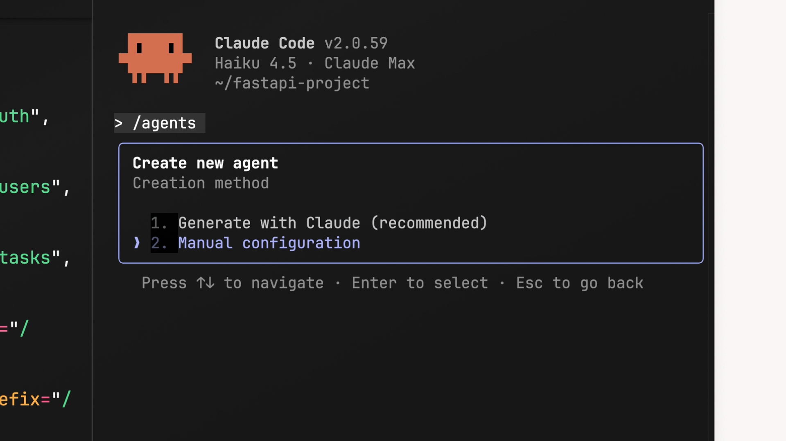
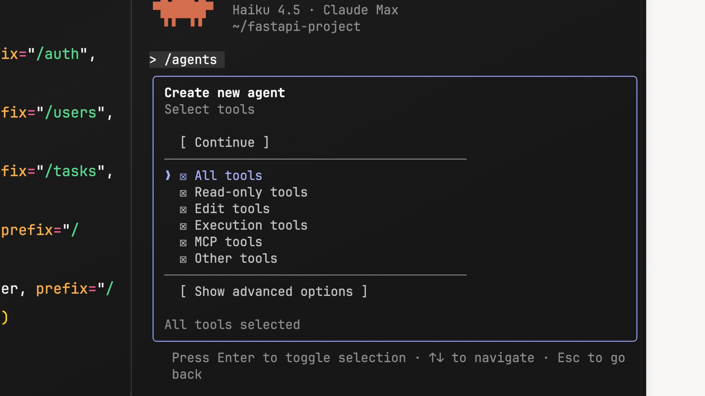
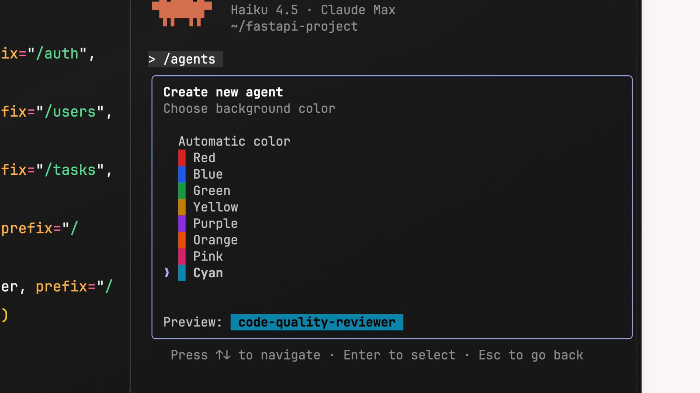
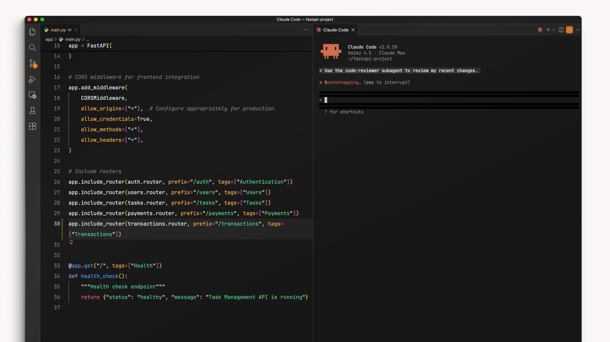

## 학습 목표

- `/agents` 명령으로 커스텀 서브에이전트를 만드는 흐름 익히기
- scope, 도구 접근, 모델, 색상 설정 이해하기
- 서브에이전트 config 파일(YAML frontmatter + system prompt)의 각 필드 파악하기

## 한눈에 보는 흐름

<ol class="oa-flow">
  <li><strong>/agents</strong>Create new agent 선택</li>
  <li><strong>scope</strong>Project 또는 User</li>
  <li><strong>생성 방식</strong>Claude 생성 권장</li>
  <li><strong>도구·모델·색상</strong>필요한 것만 부여</li>
  <li><strong>config 저장</strong>.claude/agents/이름.md</li>
  <li><strong>테스트</strong>기대한 때에 불리는지 확인</li>
</ol>

## `/agents`로 만들기

가장 쉬운 방법은 **`/agents`** 슬래시 명령입니다. 서브에이전트 관리 인터페이스가 열리면 **Create new agent**를 선택합니다.

먼저 **scope**를 고릅니다.

<div class="oa-vs">
  <div class="oa-vs__good">
    <span class="oa-vs__label">Project-level</span>
    <ul>
      <li>현재 프로젝트에서만 사용</li>
    </ul>
  </div>
  <div class="oa-vs__good">
    <span class="oa-vs__label">User-level</span>
    <ul>
      <li>내 컴퓨터의 모든 프로젝트에서 공유</li>
    </ul>
  </div>
</div>

그다음 생성 방식을 고릅니다. 수동으로 작성할 수도 있지만, **권장은 Claude가 생성하게 하는 것**입니다 — 원하는 바를 설명하면 Claude가 이름·설명·system prompt를 만들어 줍니다.



## 도구 접근 커스터마이징

생성 중 서브에이전트가 접근할 도구를 고를 수 있습니다. 카테고리는 **Read-only / Edit / Execution / MCP / Other**입니다. 서브에이전트가 실제로 필요한 것만 생각하세요 — 예: code reviewer는 편집 도구가 필요 없고 읽고 분석만 하면 됩니다(단, pending 변경을 파악하도록 execution 도구는 켜둘 수 있음).



## 모델과 색상 선택

- **모델**: Haiku(빠르고 가벼운 작업) / Sonnet(속도·깊이의 중간) / Opus(복잡한 분석) / **Inherit**(메인 대화의 모델 사용)
- **색상**: UI에서 어떤 서브에이전트가 활성인지 빠르게 구분하기 위한 것



## config 파일

<div class="oa-eli">
  <span class="oa-eli__head">🪪 쉽게 말하면</span>
  <p>config 파일은 신입 사원의 <b>직무 기술서</b>입니다. 위쪽 frontmatter는 이름, 언제 부를지, 쓸 수 있는 도구를 적은 명찰이고, 아래 본문은 "이 일을 이렇게 해 주세요"라는 업무 지침(system prompt)입니다.</p>
</div>

생성이 끝나면 config가 프로젝트에 저장됩니다(보통 `.claude/agents/이름.md`). 전형적인 형태:

```text
---
name: code-quality-reviewer
description: Use this agent when you need to review recently written or modified code for quality, security, and best practice compliance.
tools: Bash, Glob, Grep, Read, WebFetch, WebSearch
model: sonnet
color: purple
---

You are an expert code reviewer specializing in quality assurance, security best practices, and
adherence to project standards. ...
```

각 필드:

| 필드 | 역할 | 메모 |
|---|---|---|
| **name** | 고유 식별자 | `@agent code-quality-reviewer`처럼 참조하거나 Claude에게 직접 요청할 때 사용 |
| **description** | Claude가 **언제 이 서브에이전트를 쓸지** 결정하는 기준 | 한 줄이어야 하며(줄바꿈은 `\n`), 예시 대화를 넣어 위임 시점을 학습시킬 수 있음 |
| **tools** | 접근 가능한 도구 목록 | 생성 시 선택한 것, 이후 편집 가능 |
| **model** | 사용할 모델 | sonnet, opus, haiku, inherit |
| **color** | UI 식별용 색상 | 어떤 서브에이전트가 활성인지 구분 |

YAML frontmatter 아래 본문 전체가 **system prompt**입니다 — 무엇에 집중하고, 어떻게 분석하고, 결과를 어떻게 보고할지 지시하는 곳. 잘 쓴 system prompt가 쓸모 있는 서브에이전트와 요점을 놓치는 서브에이전트를 가릅니다.

## 자동 위임 & 테스트

- Claude가 **자동으로** 위임하게 하려면 description에 **"proactively"**를 넣습니다 (예: `Proactively suggest running this agent after major code changes...`). 구체적 예시 대화를 더할수록 위임 판단이 정확해집니다.
- 만든 뒤에는 코드를 변경하고 Claude에게 리뷰를 요청해 테스트합니다. 기대한 때에 안 쓰이면 description을 더 구체적으로 다듬으세요.



## 확인 문제

<details class="oa-quiz">
  <summary>Q1. 팀원 모두가 같은 code reviewer 서브에이전트를 쓰게 하려면 어떤 scope로 만들어야 합니까?</summary>
  <p><b>정답: Project-level.</b> 프로젝트의 <code>.claude/agents/</code>에 저장되어 프로젝트와 함께 공유됩니다. User-level은 내 컴퓨터의 모든 프로젝트에서만 쓰입니다.</p>
</details>

<details class="oa-quiz">
  <summary>Q2. 만든 서브에이전트가 기대한 때에 불리지 않습니다. 가장 먼저 고칠 곳은 어디입니까?</summary>
  <p><b>정답: description.</b> Claude는 description으로 언제 위임할지 정합니다. 더 구체적으로 쓰고, 예시 대화나 "proactively"를 넣어 조절합니다.</p>
</details>

<details class="oa-quiz">
  <summary>Q3. config 파일에서 YAML frontmatter 아래 본문은 무엇으로 쓰입니까?</summary>
  <p><b>정답: system prompt.</b> 무엇에 집중하고, 어떻게 분석하고, 결과를 어떻게 보고할지 지시하는 곳입니다.</p>
</details>

## 핵심 정리

- `/agents → Create new agent`로 scope·생성방식·도구·모델·색상을 정해 만듭니다 (Claude 생성 권장).
- config는 `.claude/agents/이름.md`에 저장되며, YAML frontmatter(name·description·tools·model·color) + system prompt 본문으로 구성됩니다.
- description은 "언제 쓸지"를 결정하고, "proactively"와 예시로 자동 위임을 조절합니다.
