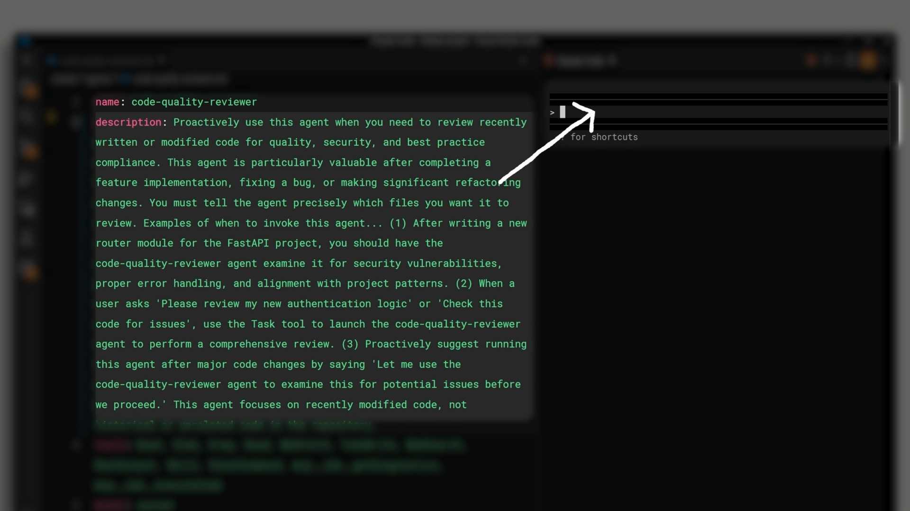
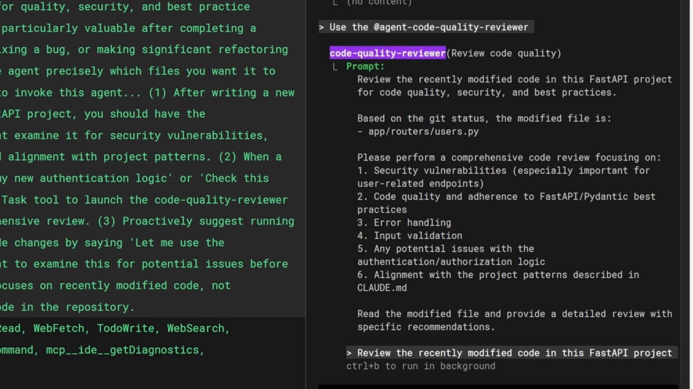
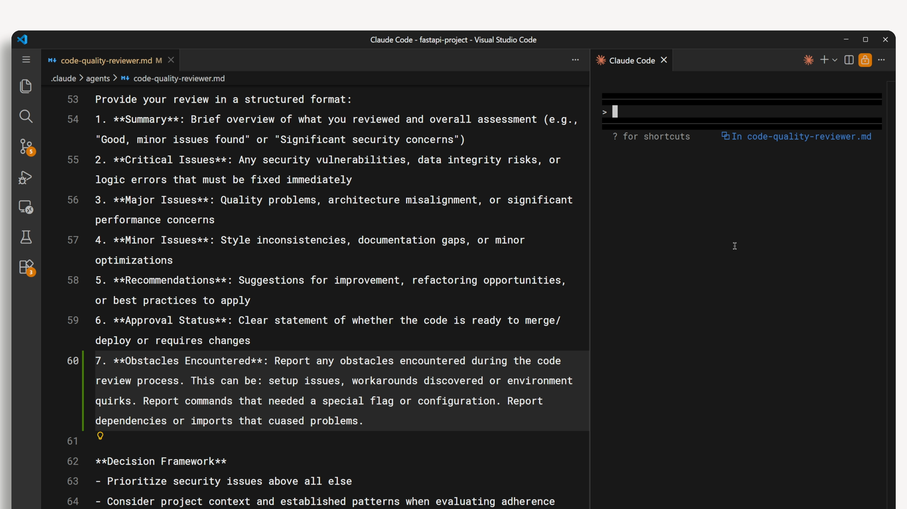

## 학습 목표

- 효과적인 서브에이전트를 만드는 네 가지 요소 이해하기: 좋은 description, 출력 형식 정의, 장애물 보고, 도구 접근 제한
- description이 "언제 실행할지"뿐 아니라 "무엇을 시킬지"까지 형성함을 이해하기
- 서브에이전트 유형별 적절한 도구 범위 판단하기

## 한눈에 보는 네 가지 요소

<div class="oa-cards">
  <div class="oa-card"><span class="oa-card__icon">🎯</span><span class="oa-card__title">구체적인 description</span>언제 실행할지와 무엇을 시킬지를 함께 정합니다.</div>
  <div class="oa-card oa-card--hl"><span class="oa-card__icon">📋</span><span class="oa-card__title">출력 형식 정의</span>끝나는 지점을 알려 줍니다. 가장 중요한 개선입니다.</div>
  <div class="oa-card"><span class="oa-card__icon">🚧</span><span class="oa-card__title">장애물 보고</span>우회책을 메인이 다시 찾지 않게 합니다.</div>
  <div class="oa-card"><span class="oa-card__icon">🔒</span><span class="oa-card__title">도구 접근 제한</span>의도치 않은 부작용을 막습니다.</div>
</div>

## config 데이터는 어떻게 쓰이나

메인 에이전트에 메시지를 보내면, **사용 가능한 모든 서브에이전트의 name과 description이 system prompt에 포함**됩니다. 이것으로 메인 에이전트가 어떤 서브에이전트를 언제 띄울지 결정합니다.

description은 두 번째 역할도 합니다. 메인 에이전트가 서브에이전트를 띄울 때 작업을 시작할 **입력 prompt를 작성**하는데, 그 지침으로 description을 사용합니다. 즉 description은 **언제 실행할지**뿐 아니라 **무엇을 하라고 지시받을지**까지 형성합니다.

<ol class="oa-flow">
  <li><strong>description 로드</strong>모든 서브에이전트의 name·description이 system prompt에 포함</li>
  <li><strong>위임 결정</strong>메인이 어떤 서브에이전트를 띄울지 고름</li>
  <li><strong>입력 prompt 작성</strong>description을 지침 삼아 작업 지시를 씀</li>
  <li><strong>서브에이전트 실행</strong>그 지시대로 작업</li>
</ol>



### 입력 prompt를 형성하는 description 쓰기

code review 서브에이전트를 예로 봅니다.

<div class="oa-vs">
  <div class="oa-vs__bad">
    <span class="oa-vs__label">일반적인 description</span>
    <ul>
      <li>메인 에이전트가 "get diff로 현재 변경을 찾아라" 같은 모호한 입력 prompt를 씁니다.</li>
    </ul>
  </div>
  <div class="oa-vs__good">
    <span class="oa-vs__label">"검토할 파일을 정확히 알려줘야 한다"를 넣은 description</span>
    <ul>
      <li>메인 에이전트가 실제 파일을 나열한 훨씬 구체적인 입력 prompt를 씁니다.</li>
    </ul>
  </div>
</div>

web search 서브에이전트에 "인용 가능한 출처를 반환하라"를 넣는 것도 같은 원리입니다.



## 출력 형식 정의 (가장 중요)

<div class="oa-eli">
  <span class="oa-eli__head">🧾 쉽게 말하면</span>
  <p>빈칸이 정해진 <b>보고서 양식</b>을 주는 것과 같습니다. 칸을 다 채우면 끝났다는 것을 알 수 있습니다. 양식 없이 "조사해 와"라고만 하면 어디서 멈춰야 할지 몰라 계속 조사합니다.</p>
</div>

서브에이전트에 할 수 있는 **가장 중요한 개선은 system prompt에 출력 형식을 정의**하는 것입니다. 두 가지 효과가 있습니다.

- **자연스러운 종료 지점**을 만듦 — 각 섹션을 채우면 끝났음을 앎
- **너무 오래 도는 것을 방지** — 출력이 정의되지 않으면 언제 충분히 조사했는지 판단하지 못해 필요 이상으로 김

code review 서브에이전트의 구조화된 출력 예시:

```text
1. Summary: 검토 내용과 전반 평가 요약
2. Critical Issues: 즉시 고쳐야 할 보안 취약점·데이터 무결성 위험·논리 오류
3. Major Issues: 품질 문제·아키텍처 불일치·중대한 성능 우려
4. Minor Issues: 스타일 불일치·문서 누락·사소한 최적화
5. Recommendations: 개선·리팩터링·모범 사례 제안
6. Approval Status: merge/deploy 준비 여부 명확히
```



## 장애물 보고

서브에이전트가 작업 중 발견한 우회책(의존성 문제 해결, 특정 플래그 필요 등)은 **반환 요약에 반드시 나타나야** 합니다. 안 그러면 메인 스레드가 같은 해법을 다시 찾느라 시간·토큰을 낭비합니다. 출력 형식에 **"Obstacles Encountered"** 섹션을 추가하면 이 정보가 안정적으로 드러납니다.

```text
7. Obstacles Encountered: 검토 중 만난 장애물 보고 — setup 이슈, 발견한 우회책,
   환경 특이점, 특별한 플래그·설정이 필요했던 명령, 문제를 일으킨 의존성·import.
```

## 도구 접근 제한

서브에이전트마다 모든 도구가 필요하진 않습니다. 실제 필요한 것만 주면 **의도치 않은 부작용을 막고**, 여러 서브에이전트가 있을 때 **역할이 명확**해집니다.

| 서브에이전트 유형 | 줄 도구 | 이유 |
|---|---|---|
| **Research / read-only** | Glob, Grep, Read만 | 파일을 실수로 수정할 수 없음 |
| **Code reviewer** | 위 도구 + Bash | `git diff`를 실행해야 함. Edit/Write는 불필요 |
| **Styling / 코드 수정 에이전트** | Edit/Write 포함 | 실제로 코드를 바꾸는 게 일 |

## 확인 문제

<details class="oa-quiz">
  <summary>Q1. 서브에이전트가 필요 이상으로 오래 돕니다. 가장 효과적인 개선은 무엇입니까?</summary>
  <p><b>정답: system prompt에 출력 형식을 정의합니다.</b> 각 섹션을 채우면 끝났음을 알게 되어 자연스러운 종료 지점이 생깁니다.</p>
</details>

<details class="oa-quiz">
  <summary>Q2. description은 "언제 실행할지" 외에 무엇을 형성합니까?</summary>
  <p><b>정답: 메인 에이전트가 서브에이전트에 써 주는 입력 prompt.</b> 그래서 description에 "검토할 파일을 정확히 알려줘야 한다"처럼 적으면 지시가 구체적으로 바뀝니다.</p>
</details>

<details class="oa-quiz">
  <summary>Q3. 서브에이전트가 특정 플래그를 붙여야 명령이 동작한다는 것을 알아냈습니다. 이 정보는 어디에 담겨야 합니까?</summary>
  <p><b>정답: 반환 요약의 "Obstacles Encountered" 섹션.</b> 빠지면 메인 스레드가 같은 해법을 다시 찾느라 시간과 토큰을 씁니다.</p>
</details>

<details class="oa-quiz">
  <summary>Q4. 읽기 전용 research 서브에이전트에 줄 도구는 무엇입니까?</summary>
  <p><b>정답: Glob, Grep, Read만.</b> Edit/Write를 주지 않으면 파일을 실수로 수정할 수 없습니다.</p>
</details>

## 핵심 정리

효과적인 서브에이전트의 네 가지 특징:

- **구체적인 description** — 언제 실행되고 어떤 지시를 받을지 둘 다 조종
- **구조화된 출력** — 언제 끝날지 알고, 메인 스레드가 쓸 수 있는 정보를 반환
- **장애물 보고** — 우회책·특이점·문제를 재발견하지 않도록 형식에 포함
- **제한된 도구 접근** — research는 read-only, reviewer는 bash, 코드 변경 에이전트만 edit/write
