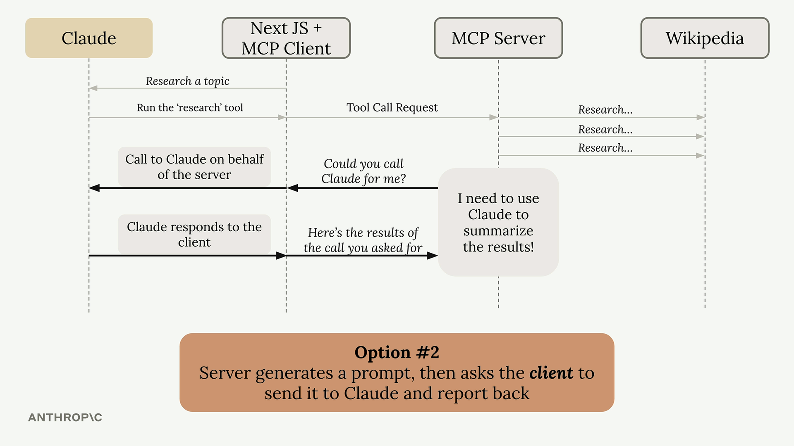

## 학습 목표

- Sampling이 무엇이고 어떤 문제를 푸는지 이해하기
- Sampling의 요청 흐름과 이점 파악하기
- 서버·클라이언트 양쪽 구현 방식 익히기

## 한눈에 보는 흐름

<ol class="oa-flow">
  <li><strong>서버 작업 완료</strong>예: Wikipedia 문서 수집</li>
  <li><strong>prompt 생성</strong>서버가 텍스트 생성용 prompt를 만듦</li>
  <li><strong>sampling 요청</strong>서버 → 클라이언트</li>
  <li><strong>Claude 호출</strong>클라이언트가 대신 호출</li>
  <li><strong>텍스트 반환</strong>클라이언트 → 서버</li>
  <li><strong>응답에 사용</strong>서버가 결과를 씀</li>
</ol>

## Sampling이란

**Sampling**은 서버가 연결된 MCP 클라이언트를 통해 Claude 같은 언어 모델에 접근하게 해줍니다. 서버가 Claude를 직접 호출하는 대신, **클라이언트에게 대신 호출해달라고 요청**합니다. 이로써 텍스트 생성의 책임과 비용이 서버에서 클라이언트로 옮겨갑니다.

<div class="oa-eli">
  <span class="oa-eli__head">📞 쉽게 말하면</span>
  <p>전화기가 없는 가게 주인이 손님에게 <b>"손님 전화로 대신 걸어 주시겠어요?"</b>라고 부탁하는 것과 같습니다. 가게(서버)는 전화 요금제(API key)를 갖출 필요가 없고, 통화 요금(토큰 비용)은 전화기를 가진 손님(클라이언트)이 냅니다.</p>
</div>

## 어떤 문제를 푸나

Wikipedia에서 정보를 가져오는 research 도구가 있는 MCP 서버를 상상해봅시다. 모은 데이터를 보고서로 요약하려면 두 가지 선택지가 있습니다.

<div class="oa-vs">
  <div class="oa-vs__bad">
    <span class="oa-vs__label">Option 1: 서버에 Claude 직접 접근 부여</span>
    <ul>
      <li>서버가 자체 API key, 인증, 비용, Claude 연동 코드를 모두 관리</li>
      <li>되지만 복잡도가 큽니다.</li>
    </ul>
  </div>
  <div class="oa-vs__good">
    <span class="oa-vs__label">Option 2: Sampling 사용</span>
    <ul>
      <li>서버가 prompt를 만들어 클라이언트에게 "Claude를 대신 호출해줄래?"라고 요청</li>
      <li>이미 Claude 연결을 가진 클라이언트가 호출하고 결과를 돌려줍니다.</li>
    </ul>
  </div>
</div>



## 동작 흐름

| 순서 | 누가 | 하는 일 |
|---|---|---|
| 1 | 서버 | 작업 완료 (예: Wikipedia 문서 수집) |
| 2 | 서버 | 텍스트 생성용 prompt 생성 |
| 3 | 서버 → 클라이언트 | sampling 요청 전송 |
| 4 | 클라이언트 | 그 prompt로 Claude 호출 |
| 5 | 클라이언트 → 서버 | 생성된 텍스트 반환 |
| 6 | 서버 | 그 텍스트를 응답에 사용 |

## 이점

<div class="oa-cards">
  <div class="oa-card"><span class="oa-card__icon">🧹</span><span class="oa-card__title">서버 복잡도 감소</span>언어 모델과 직접 연동할 필요 없음</div>
  <div class="oa-card"><span class="oa-card__icon">💸</span><span class="oa-card__title">비용 부담 이전</span>토큰 비용을 클라이언트가 부담</div>
  <div class="oa-card"><span class="oa-card__icon">🔑</span><span class="oa-card__title">API key 불필요</span>서버가 Claude 자격증명을 가질 필요 없음</div>
  <div class="oa-card oa-card--hl"><span class="oa-card__icon">🌍</span><span class="oa-card__title">공개 서버에 이상적</span>공개 서버가 모든 사용자의 AI 비용을 떠안지 않음</div>
</div>

## 구현

**서버 측** — 도구 함수에서 `create_message`로 텍스트 생성 요청:

```python
@mcp.tool()
async def summarize(text_to_summarize: str, ctx: Context):
    prompt = f"Please summarize the following text:\n{text_to_summarize}"
    result = await ctx.session.create_message(
        messages=[SamplingMessage(role="user",
            content=TextContent(type="text", text=prompt))],
        max_tokens=4000,
        system_prompt="You are a helpful research assistant",
    )
    if result.content.type == "text":
        return result.content.text
    raise ValueError("Sampling failed")
```

**클라이언트 측** — 서버 요청을 처리할 sampling callback 작성 후 세션 초기화 시 전달:

```python
async def sampling_callback(context, params):
    text = await chat(params.messages)  # Anthropic SDK로 Claude 호출
    return CreateMessageResult(role="assistant", model=model,
        content=TextContent(type="text", text=text))

async with ClientSession(read, write, sampling_callback=sampling_callback) as session:
    await session.initialize()
```

> **코드 walkthrough**: 강의의 `sampling.zip` 예제로 위 서버·클라이언트 구현을 직접 실행해볼 수 있습니다.

## 확인 문제

<details class="oa-quiz">
  <summary>Q1. Sampling에서 Claude를 실제로 호출하는 쪽은 어디입니까?</summary>
  <p><b>정답: 클라이언트.</b> 서버는 prompt를 만들어 요청만 하고, 이미 Claude 연결을 가진 클라이언트가 호출해 결과를 돌려줍니다.</p>
</details>

<details class="oa-quiz">
  <summary>Q2. 공개 MCP 서버에 Sampling이 특히 유용한 이유는 무엇입니까?</summary>
  <p><b>정답: 서버가 모든 사용자의 AI 비용을 떠안지 않기 때문입니다.</b> 각 클라이언트가 자기 토큰 비용을 부담하고, 서버는 API key도 필요 없습니다.</p>
</details>

<details class="oa-quiz">
  <summary>Q3. Sampling을 구현하려면 서버와 클라이언트에 각각 무엇이 필요합니까?</summary>
  <p><b>정답: 서버의 <code>create_message</code> 호출과 클라이언트의 <code>sampling_callback</code>.</b> callback은 세션 초기화 시 전달합니다.</p>
</details>

## 핵심 정리

- Sampling은 서버가 클라이언트를 통해 Claude를 호출하게 해, AI 연동 복잡도와 비용을 클라이언트로 옮깁니다.
- 특히 **공개 MCP 서버**에서 가치가 큽니다 — 각 클라이언트가 자기 AI 사용 비용을 부담합니다.
- 구현은 서버의 `create_message`와 클라이언트의 `sampling_callback` 양쪽 코드가 필요합니다.
