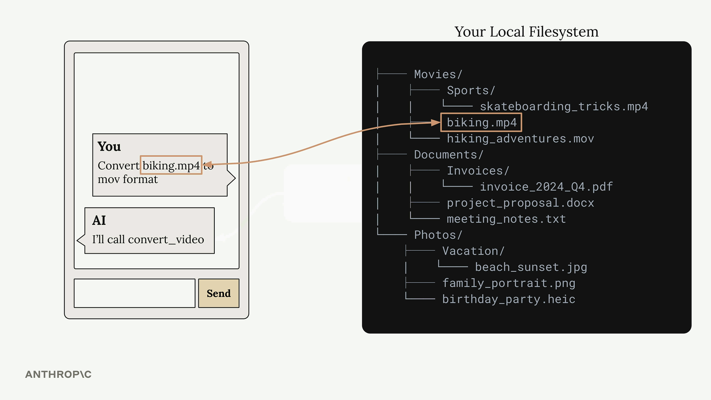

## 학습 목표

- Roots가 무엇이고 어떤 문제를 푸는지 이해하기
- Roots를 이용한 파일 탐색 흐름과 보안 경계 파악하기
- `is_path_allowed()` 패턴으로 직접 구현해야 함을 이해하기

## 한눈에 보는 흐름

<ol class="oa-flow">
  <li><strong>사용자 요청</strong>"biking.mp4를 mov로 변환해줘"</li>
  <li><strong>list_roots</strong>접근 가능한 디렉터리 확인</li>
  <li><strong>read_dir</strong>그 디렉터리를 탐색해 파일 찾기</li>
  <li><strong>도구 호출</strong>전체 경로로 변환 도구 실행</li>
</ol>

## Roots란

**Roots**는 MCP 서버에 로컬 컴퓨터의 특정 파일·폴더 접근을 허가하는 방법입니다. "이 파일들에 접근해도 돼"라고 말하는 권한 시스템이면서, 그 이상의 역할을 합니다.

  🔑 쉽게 말하면
  
집 수리 기사에게 <b>"주방과 욕실만 들어가셔도 됩니다"</b>라고 알려 주는 것과 같습니다. 기사는 그 방들을 직접 둘러보며 고칠 곳을 찾을 수 있고(탐색), 안방에는 들어갈 수 없습니다(보안 경계).

## 어떤 문제를 푸나

MP4를 MOV로 변환하는 도구가 있는 서버를 상상해봅시다. 사용자가 "biking.mp4를 mov로 변환해줘"라고 하면 Claude는 파일명만으로 도구를 호출하는데, **Claude는 그 파일이 파일시스템 어디에 있는지 검색할 방법이 없습니다.** 매번 전체 경로를 입력하게 하는 건 불편합니다.

## Roots를 쓴 흐름

1. 사용자가 비디오 변환 요청
2. Claude가 `list_roots`로 접근 가능한 디렉터리 확인
3. Claude가 `read_dir`로 그 디렉터리를 탐색해 파일을 찾음
4. 찾으면 전체 경로로 변환 도구 호출

  

    Roots 없이
    <ul>
      <li>Claude는 파일이 어디에 있는지 검색할 방법이 없습니다.</li>
      <li>사용자가 매번 전체 경로를 입력해야 합니다.</li>
    </ul>
  

  

    Roots 사용
    <ul>
      <li>"biking.mp4 변환"만 말하면 됩니다.</li>
      <li>승인된 디렉터리 안에서 Claude가 파일을 찾습니다.</li>
    </ul>
  

이 모든 게 자동으로 일어나, 사용자는 전체 경로 없이 "biking.mp4 변환"만 말하면 됩니다.

## 보안과 경계

Roots는 **접근을 제한해 보안**도 제공합니다. Desktop 폴더만 허가하면 서버는 Documents·Downloads 같은 다른 위치에 접근할 수 없습니다. 승인된 roots 밖 파일에 접근하려 하면 오류가 나고, 사용자에게 접근 불가를 알립니다.

## 구현

MCP SDK는 root 제한을 **자동으로 강제하지 않으므로, 직접 구현**해야 합니다. 전형적 패턴은 `is_path_allowed()` 헬퍼 함수:

<ol class="oa-flow">
  <li><strong>경로 받기</strong>요청된 파일 경로를 받음</li>
  <li><strong>roots 조회</strong>승인된 roots 목록을 가져옴</li>
  <li><strong>포함 여부 확인</strong>요청 경로가 그중 하나 안에 있는지</li>
  <li><strong>반환</strong>접근 허용 여부를 true/false로</li>
</ol>

파일·디렉터리에 접근하는 모든 도구에서 실제 작업 전에 이 함수를 호출합니다.

## 이점

  
🙂사용자 친화전체 경로 불필요

  
🎯집중된 탐색승인된 디렉터리만 보므로 파일 탐색이 빠름

  
🛡️보안승인 영역 밖 민감 파일 접근 방지

  
🔧유연성roots를 도구로 제공하거나 prompt에 직접 주입 가능

> **코드 walkthrough**: 강의의 Roots walkthrough 예제로 `is_path_allowed()` 구현을 직접 볼 수 있습니다.

## 확인 문제

  
Q1. MCP SDK는 승인된 roots 밖의 파일 접근을 자동으로 막아 줍니까?

  
<b>정답: 아닙니다.</b> SDK는 root 제한을 자동으로 강제하지 않습니다. <code>is_path_allowed()</code> 같은 헬퍼를 직접 만들어, 파일에 접근하는 모든 도구에서 실제 작업 전에 호출해야 합니다.

  
Q2. 사용자가 파일명만 말해도 Claude가 파일을 찾을 수 있는 것은 어떤 과정 덕분입니까?

  
<b>정답: <code>list_roots</code>로 접근 가능한 디렉터리를 확인하고 <code>read_dir</code>로 그 안을 탐색하기 때문입니다.</b>

  
Q3. Desktop 폴더만 root로 허가했습니다. 서버가 Documents의 파일에 접근하려 하면 어떻게 됩니까?

  
<b>정답: 오류가 나고 사용자에게 접근 불가를 알립니다.</b> Roots는 탐색을 돕는 동시에 보안 경계입니다.

## 핵심 정리

- Roots는 서버에 특정 로컬 파일·폴더 접근을 허가해, Claude가 파일명만으로도 파일을 찾게 합니다.
- 동시에 승인 영역 밖 접근을 막는 **보안 경계**입니다.
- SDK가 강제하지 않으므로 `is_path_allowed()` 같은 패턴으로 직접 구현해야 합니다.
