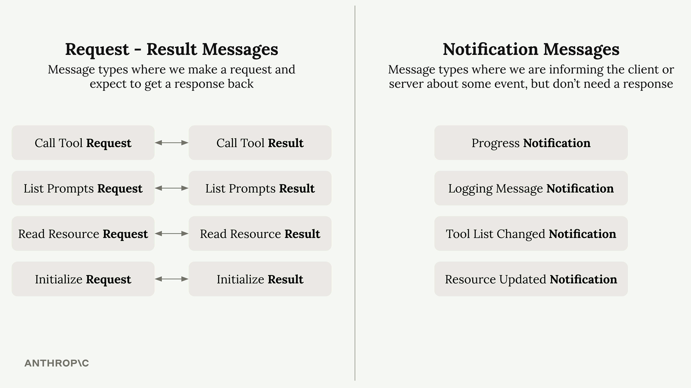

## 학습 목표

- MCP가 JSON 메시지로 통신함을 이해하기
- Request-Result 메시지와 Notification 메시지를 구분하기
- MCP가 양방향 프로토콜이며, 이것이 transport 선택에 왜 중요한지 파악하기

## 한눈에 보는 두 범주

  

    Request-Result
    <ul>
      <li>항상 쌍으로 옵니다.</li>
      <li>요청을 보내고 결과를 기대합니다.</li>
      <li>예: Call Tool Request → Call Tool Result</li>
    </ul>
  

  

    Notification
    <ul>
      <li>단방향입니다.</li>
      <li>응답이 필요 없습니다.</li>
      <li>예: Progress Notification</li>
    </ul>
  

## 메시지 형식

MCP의 모든 통신은 **JSON 메시지**로 이뤄집니다. Claude가 도구를 호출할 때 클라이언트가 "Call Tool Request"를 보내면, 서버가 도구를 실행하고 "Call Tool Result"로 응답합니다.

전체 메시지 유형은 GitHub의 **공식 MCP 명세(specification)** 저장소에 정의돼 있습니다. 이 명세는 SDK 저장소(Python·TypeScript 등)와 별개이며, MCP가 어떻게 동작해야 하는지의 권위 있는 출처입니다. 메시지 유형은 편의상 **TypeScript로 기술**되는데, 실행용이 아니라 데이터 구조·타입을 명확히 표현하기 위함입니다.

## 두 가지 범주

  ✉️ 쉽게 말하면
  
Request-Result는 <b>답장을 기다리는 편지</b>이고, Notification은 <b>답장이 필요 없는 공지 문자</b>입니다. "주문하신 상품이 출발했습니다"라는 문자에 답장하지 않는 것과 같습니다.

### Request-Result 메시지

항상 쌍으로 옵니다. 요청을 보내고 결과를 기대합니다.

| 요청 | 결과 |
|---|---|
| Call Tool Request | Call Tool Result |
| List Prompts Request | List Prompts Result |
| Read Resource Request | Read Resource Result |
| Initialize Request | Initialize Result |

### Notification 메시지

이벤트를 알리는 **단방향** 메시지로, 응답이 필요 없습니다.

  
📈Progress Notification장기 작업 진행 업데이트

  
📝Logging Message Notification시스템 로그

  
🧰Tool List Changed Notification사용 가능 도구 변경 시

  
🔄Resource Updated Notification리소스 수정 시

## Client vs Server 메시지

명세는 **누가 보내는지**로 메시지를 구분합니다.

- **Client 메시지** — 클라이언트가 서버에 보내는 요청(도구 호출 등)과 알림
- **Server 메시지** — 서버가 클라이언트에 보내는 요청과 브로드캐스트하는 알림

## 왜 중요한가

**서버도 클라이언트에 메시지를 보낼 수 있다**는 점이 특히 중요합니다. MCP는 **양방향(bidirectional) 프로토콜**로 설계됐습니다. 그런데 일부 transport(예: StreamableHTTP)는 **어떤 유형의 메시지가 어느 방향으로 흐를 수 있는지에 제약**이 있어, 사용 사례에 맞는 transport 선택이 중요해집니다.

## 확인 문제

  
Q1. Notification 메시지와 Request-Result 메시지의 가장 큰 차이는 무엇입니까?

  
<b>정답: Notification은 응답이 필요 없는 단방향 메시지입니다.</b> Request-Result는 항상 쌍으로 옵니다.

  
Q2. MCP에서 서버가 먼저 클라이언트에 요청을 보낼 수 있습니까?

  
<b>정답: 있습니다.</b> MCP는 양방향 프로토콜입니다. 다만 StreamableHTTP 같은 일부 transport는 메시지가 흐를 수 있는 방향에 제약이 있습니다.

  
Q3. MCP 메시지 유형의 권위 있는 출처는 어디입니까?

  
<b>정답: GitHub의 공식 MCP 명세 저장소.</b> SDK 저장소와 별개이며, 유형은 데이터 구조를 명확히 하려고 TypeScript로 기술돼 있습니다.

## 핵심 정리

- MCP는 JSON 메시지로 통신하며, 유형은 공식 명세에 TypeScript로 정의됩니다.
- 메시지는 **Request-Result(응답 기대)**와 **Notification(응답 불필요)** 두 범주로 나뉩니다.
- MCP는 양방향 프로토콜이라 서버도 요청을 시작할 수 있는데, transport에 따라 이 방향에 제약이 생깁니다.
