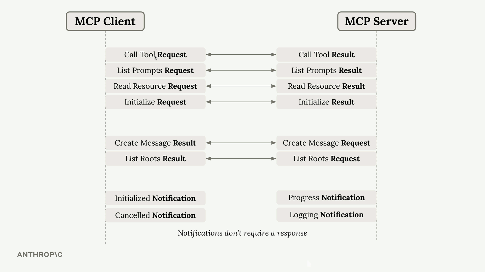

## 학습 목표

- transport가 무엇이고 STDIO transport가 어떻게 동작하는지 이해하기
- MCP 연결의 3-메시지 handshake 파악하기
- STDIO가 왜 양방향 통신의 "이상적" 기준인지 이해하기

## 한눈에 보는 handshake

<ol class="oa-flow">
  <li><strong>Initialize Request</strong>클라이언트가 먼저 전송</li>
  <li><strong>Initialize Result</strong>서버가 capabilities로 응답</li>
  <li><strong>Initialized Notification</strong>클라이언트가 확인 (응답 없음)</li>
  <li><strong>이후 요청 가능</strong>도구 호출, prompt 목록 등</li>
</ol>

## transport란

MCP client와 server는 JSON 메시지를 주고받지만, **그 메시지가 실제로 어떻게 전송되는지**를 담당하는 통신 채널이 **transport**입니다. HTTP, WebSocket 등 여러 방식이 있습니다.

## STDIO transport

서버·클라이언트를 처음 개발할 때 가장 흔히 쓰는 것이 **STDIO transport**입니다. 클라이언트가 MCP 서버를 **서브프로세스로 실행**하고, **표준 입출력(stdin/stdout)** 스트림으로 통신합니다.

  🥫 쉽게 말하면
  
<b>실 전화기</b>(종이컵 두 개를 실로 이은 것)와 같습니다. 어느 쪽이든 언제든 말할 수 있어서 단순하고 확실합니다. 대신 실이 닿는 거리, 즉 <b>같은 머신</b> 안에서만 쓸 수 있습니다.

- 클라이언트가 서버의 **stdin**으로 메시지 전송
- 서버가 **stdout**에 써서 응답
- 서버·클라이언트 어느 쪽이든 언제든 메시지 전송 가능
- **같은 머신**에서만 동작

터미널에서 `uv run server.py`로 서버를 실행하면 stdin을 듣고 stdout에 응답하므로, JSON 메시지를 터미널에 직접 붙여넣어 응답을 즉시 볼 수 있습니다.

## MCP 연결 시퀀스 (handshake)

모든 MCP 연결은 특정 **3-메시지 handshake**로 시작해야 합니다.

1. **Initialize Request** — 클라이언트가 먼저 전송
2. **Initialize Result** — 서버가 capabilities로 응답
3. **Initialized Notification** — 클라이언트가 확인(응답 없음)

이 handshake 후에야 도구 호출·prompt 목록 같은 다른 요청을 보낼 수 있습니다.

## 네 가지 통신 시나리오

어떤 transport든 네 가지 통신 패턴을 다뤄야 합니다.

| 통신 패턴 | STDIO에서 |
|---|---|
| **Client → Server 요청** | 클라이언트가 stdin에 씀 |
| **Server → Client 응답** | 서버가 stdout에 씀 |
| **Server → Client 요청** | 서버가 stdout에 씀 |
| **Client → Server 응답** | 클라이언트가 stdin에 씀 |

STDIO의 아름다움은 단순함입니다 — 두 채널로 어느 쪽이든 언제든 통신을 시작할 수 있습니다.

## 왜 중요한가

STDIO는 양방향 통신이 매끄러운 **"이상적" 경우**입니다. HTTP 같은 다른 transport로 가면 **서버가 항상 클라이언트에 요청을 시작할 수는 없는** 제약을 만납니다. STDIO는 다른 transport의 제약을 이해하기 위한 기준선입니다. 개발·테스트엔 STDIO가 완벽하지만, client와 server가 다른 머신에 있어야 하는 배포에는 다른 transport가 필요합니다.

## 확인 문제

  
Q1. MCP 연결을 시작할 때 주고받는 세 메시지를 순서대로 말해 보세요.

  
<b>정답: Initialize Request → Initialize Result → Initialized Notification.</b> 이 handshake가 끝나야 도구 호출 같은 다른 요청을 보낼 수 있습니다.

  
Q2. STDIO transport의 가장 큰 제약은 무엇입니까?

  
<b>정답: 같은 머신에서만 동작합니다.</b> 클라이언트가 서버를 서브프로세스로 실행하기 때문입니다. 개발·테스트에는 알맞지만 원격 배포에는 다른 transport가 필요합니다.

  
Q3. STDIO를 다른 transport의 "기준선"이라고 부르는 이유는 무엇입니까?

  
<b>정답: 양방향 통신이 매끄러운 이상적인 경우이기 때문입니다.</b> 어느 쪽이든 언제든 통신을 시작할 수 있습니다. HTTP로 가면 서버가 클라이언트에 요청을 시작하기 어렵다는 제약을 만납니다.

## 핵심 정리

- transport는 JSON 메시지가 실제로 전송되는 채널이며, STDIO는 서버를 서브프로세스로 띄워 stdin/stdout으로 통신합니다.
- 모든 연결은 Initialize Request → Initialize Result → Initialized Notification의 handshake로 시작합니다.
- STDIO는 양방향 통신이 매끄러운 기준선이지만 같은 머신에서만 동작합니다.
