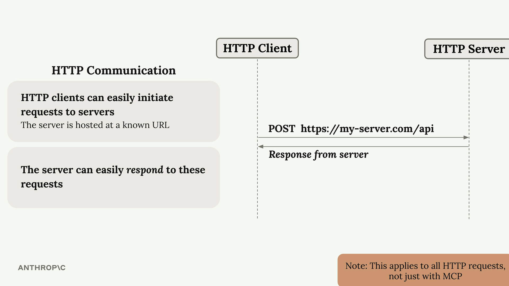

## 학습 목표

- StreamableHTTP transport가 무엇을 가능하게 하는지 이해하기
- `stateless_http`·`json_response` 설정이 기능을 어떻게 제한하는지 파악하기
- HTTP의 방향 제약이 어떤 MCP 메시지 유형에 영향을 주는지 알기

## 한눈에 보는 비교

| | STDIO | StreamableHTTP |
|---|---|---|
| 위치 | 같은 머신 | 원격 호스팅 가능 |
| 서버 → 클라이언트 요청 | 언제든 가능 | HTTP 구조상 어려움 |
| 주의할 설정 | 없음 | `stateless_http`, `json_response` |

## StreamableHTTP transport란

**StreamableHTTP transport**는 MCP 클라이언트가 **원격 호스팅된 서버**에 HTTP로 연결하게 합니다. 같은 머신을 요구하는 STDIO와 달리, 누구나 접근 가능한 **공개 MCP 서버**를 가능하게 합니다.

> ⚠️ 중요: 일부 설정이 서버 기능을 크게 제한할 수 있습니다. 로컬에서 STDIO로는 완벽히 되던 앱이 HTTP로 배포하니 깨진다면, 이 설정이 원인일 가능성이 큽니다.

## 문제가 되는 두 설정

- **`stateless_http`** — 연결 상태 관리 제어
- **`json_response`** — 응답 형식 처리 제어

기본값은 둘 다 `false`지만, 특정 배포 시나리오에서 `true`로 강제될 수 있습니다. 켜지면 **progress notification·logging·서버 시작 요청** 같은 핵심 기능이 깨질 수 있습니다.

## HTTP 통신의 제약

  🏪 쉽게 말하면
  
HTTP는 <b>손님이 가게를 찾아가는 구조</b>입니다. 가게 주소(URL)는 알려져 있으니 손님은 언제든 갈 수 있습니다. 하지만 가게는 손님의 주소를 모르기 때문에 먼저 찾아갈 수 없습니다. 서버가 클라이언트에 먼저 말을 걸기 어려운 이유입니다.

표준 HTTP에서는:

  

    어려운 것
    <ul>
      <li>서버는 클라이언트(알려진 URL 없음)에 <b>요청을 시작하기 어려움</b></li>
      <li>클라이언트→서버 응답 패턴도 까다로워짐</li>
    </ul>
  

  

    쉬운 것
    <ul>
      <li>클라이언트는 서버(알려진 URL)에 <b>요청을 쉽게 시작</b></li>
      <li>서버는 그 요청에 <b>쉽게 응답</b></li>
    </ul>
  

## 영향받는 MCP 메시지 유형

이 HTTP 제약은 특정 MCP 패턴에 영향을 줍니다.

  
📤서버 시작 요청Create Message 요청, List Roots 요청

  
🔔알림Progress, Logging, Initialized, Cancelled notification

바로 이것들이 제한적 HTTP 설정을 켤 때 깨집니다 — 진행 바가 사라지고, 로깅이 멈추고, 서버 시작 sampling 요청이 실패합니다.

## 해결책과 트레이드오프

StreamableHTTP는 HTTP 제약을 우회하는 영리한 해결책을 제공합니다(다음 레슨에서 상세히). 다만 `stateless_http=True`나 `json_response=True`로 강제되면, 우회하는 대신 **HTTP 제약 안에서 동작**하게 됩니다. 앱이 서버 시작 요청이나 실시간 알림에 크게 의존한다면 transport 선택이나 대안 통신 패턴을 재고해야 합니다.

## 확인 문제

  
Q1. 로컬에서 STDIO로 잘 되던 앱이 HTTP로 배포하자 진행 바가 사라졌습니다. 무엇을 먼저 확인합니까?

  
<b>정답: <code>stateless_http</code>와 <code>json_response</code> 설정.</b> 켜져 있으면 progress notification, logging, 서버 시작 요청 같은 기능이 깨집니다.

  
Q2. 표준 HTTP에서 서버가 클라이언트에 요청을 시작하기 어려운 이유는 무엇입니까?

  
<b>정답: 클라이언트에는 알려진 URL이 없기 때문입니다.</b> 클라이언트는 서버의 URL로 쉽게 요청하지만 반대 방향은 그렇지 않습니다.

  
Q3. HTTP 제약의 영향을 받는 MCP 기능을 두 가지 이상 들어 보세요.

  
<b>정답: 서버 시작 요청(Create Message 즉 sampling, List Roots)과 알림(Progress, Logging 등).</b>

## 핵심 정리

- StreamableHTTP는 원격 서버 연결(공개 MCP 서버)을 가능하게 하지만, HTTP는 서버→클라이언트 요청을 어렵게 합니다.
- `stateless_http`·`json_response`를 켜면 서버 시작 요청·알림·sampling 같은 기능이 깨집니다.
- 서버 시작 요청·실시간 알림에 의존하는 앱이라면 transport 선택을 신중히 하세요.
