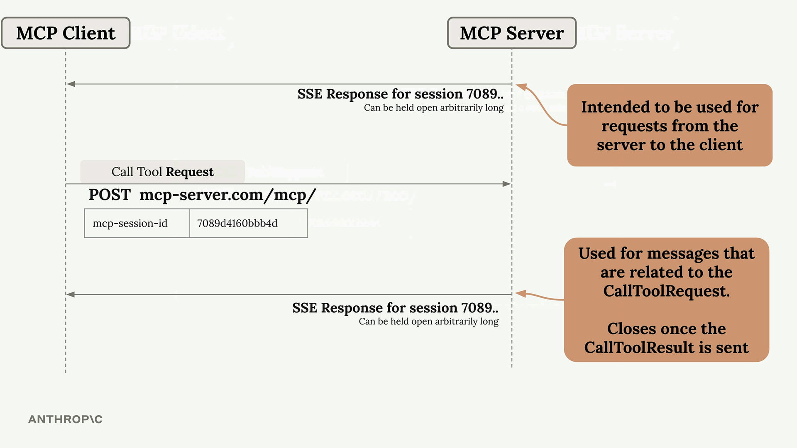

## 학습 목표

- StreamableHTTP가 Server-Sent Events(SSE)로 HTTP 제약을 어떻게 우회하는지 이해하기
- session ID와 dual SSE connection 모델 파악하기
- 어떤 메시지가 어느 연결로 라우팅되는지 알기

## 한눈에 보는 흐름

<ol class="oa-flow">
  <li><strong>Initialize Request</strong>클라이언트 전송</li>
  <li><strong>Initialize Result</strong><code>mcp-session-id</code> 헤더 포함</li>
  <li><strong>Initialized Notification</strong>session ID와 함께 전송</li>
  <li><strong>GET으로 SSE 열기</strong>서버가 언제든 스트리밍</li>
  <li><strong>도구 호출</strong>도구별 SSE 연결이 추가로 생김</li>
</ol>

## 핵심 문제

Sampling·notification·logging 같은 일부 MCP 기능은 **서버가 클라이언트에 요청을 시작**해야 하는데, HTTP는 클라이언트→서버 요청용으로 설계됐습니다. StreamableHTTP는 **Server-Sent Events(SSE)**를 이용한 영리한 우회로 이를 해결합니다.

## 초기 연결 설정

MCP 연결처럼 시작합니다.

1. 클라이언트가 **Initialize Request** 전송
2. 서버가 특별한 **`mcp-session-id` 헤더**를 포함한 **Initialize Result**로 응답
3. 클라이언트가 그 session ID로 **Initialized Notification** 전송

이 **session ID는 클라이언트를 고유하게 식별**하며, 이후 모든 요청에 포함돼야 합니다.

## SSE 우회

  📞 쉽게 말하면
  
가게가 손님에게 먼저 전화를 걸 수 없으니, 손님이 먼저 전화를 걸어 놓고 <b>끊지 않고 들고 있는 것</b>입니다. 통화가 이어져 있는 동안에는 가게가 하고 싶은 말을 언제든 전할 수 있습니다. 이 "끊지 않은 통화"가 SSE 연결입니다.

초기화 후, 클라이언트가 **GET 요청**으로 SSE 연결을 엽니다. 이는 서버가 언제든 메시지를 스트리밍할 수 있는 **오래 유지되는 HTTP 응답**을 만듭니다. 이 SSE 연결이 **서버→클라이언트 통신**의 핵심입니다.

## Dual SSE Connection

도구를 호출하면 **두 개의 별도 SSE 연결**이 생깁니다.

  

    Primary SSE Connection
    <ul>
      <li>서버 시작 요청용</li>
      <li>무기한 열려 있음</li>
    </ul>
  

  

    Tool-Specific SSE Connection
    <ul>
      <li>각 도구 호출마다 생성</li>
      <li>도구 결과가 전송되면 자동으로 닫힘</li>
    </ul>
  

### 메시지 라우팅

| 메시지 | 가는 연결 |
|---|---|
| **Progress notification** | Primary SSE connection |
| **Logging 메시지·도구 결과** | Tool-specific SSE connection |

## 우회를 깨는 플래그

- **`stateless_http`**, **`json_response`** 를 `True`로 설정하면 SSE 우회 메커니즘이 깨집니다. 특정 시나리오에서 켤 수 있지만, 서버→클라이언트 통신에 의존하는 전체 MCP 기능이 제한됩니다.

## 확인 문제

  
Q1. StreamableHTTP는 서버→클라이언트 통신 문제를 무엇으로 우회합니까?

  
<b>정답: Server-Sent Events(SSE).</b> 클라이언트가 GET 요청으로 오래 유지되는 응답을 열어 두면 서버가 언제든 메시지를 스트리밍할 수 있습니다.

  
Q2. 초기화 때 받은 <code>mcp-session-id</code>는 언제까지 필요합니까?

  
<b>정답: 이후 모든 요청.</b> 클라이언트를 고유하게 식별하는 값이라 매 요청에 포함해야 합니다.

  
Q3. Tool-specific SSE connection은 언제 닫힙니까?

  
<b>정답: 도구 결과가 전송되면 자동으로 닫힙니다.</b> Primary SSE connection은 무기한 열려 있습니다.

## 핵심 정리

- StreamableHTTP는 HTTP 제약을 SSE로 우회해, 서버→클라이언트 통신을 가능하게 합니다.
- 초기화 후 받은 **session ID는 이후 모든 요청에 필수**입니다.
- 시스템은 **primary SSE(서버 시작 요청)**와 **tool-specific SSE(도구별)** 두 연결을 자동 관리합니다.
