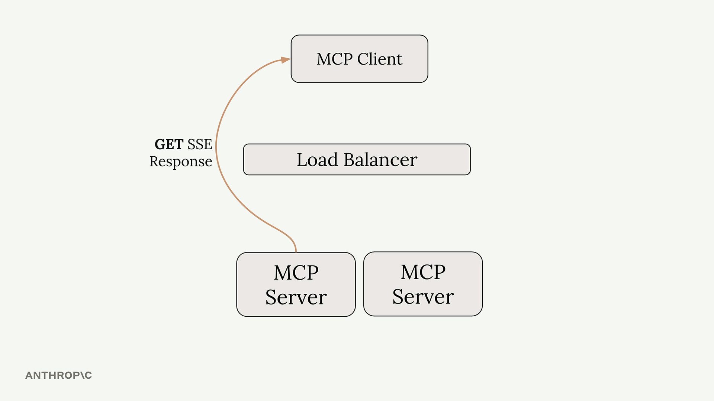

## 학습 목표

- `stateless_http`·`json_response` 플래그가 언제·왜 필요한지 이해하기
- 수평 확장(load balancer) 시 생기는 조정 문제와 stateless HTTP의 해법·트레이드오프 파악하기
- 개발과 프로덕션에서 같은 transport로 테스트해야 하는 이유 알기

## 한눈에 보는 두 플래그

  

    <code>stateless_http=True</code>
    <ul>
      <li>수평 확장의 조정 문제를 없앰</li>
      <li>session ID, 서버→클라이언트 요청, sampling, progress, subscription을 포기</li>
    </ul>
  

  

    <code>json_response=True</code>
    <ul>
      <li>POST 응답의 스트리밍을 끔</li>
      <li>최종 결과만 plain JSON으로 받음</li>
    </ul>
  

## Stateless HTTP가 필요한 때

MCP 서버가 인기를 얻어 클라이언트가 수천 개로 늘면 단일 서버 인스턴스로는 감당이 안 됩니다. 전형적 해법은 **load balancer 뒤에 여러 인스턴스를 두는 수평 확장(horizontal scaling)**입니다.

문제: MCP 클라이언트는 **두 개의 연결**이 필요합니다.

- 서버→클라이언트 요청 수신용 **GET SSE 연결**
- 도구 호출·응답용 **POST 요청**

load balancer는 이 둘을 **서로 다른 서버 인스턴스로 라우팅**할 수 있습니다. 도구가 Claude를 써야 한다면(sampling), POST를 처리한 서버가 GET SSE를 처리한 서버와 조정해야 하는 **복잡한 서버 간 조정 문제**가 생깁니다.

  ☎️ 쉽게 말하면
  
콜센터에 전화를 두 번 걸었더니 <b>서로 다른 상담원</b>이 받은 상황입니다. 첫 번째 상담원(GET SSE)에게 "결과 나오면 알려 주세요"라고 해 뒀는데, 일은 두 번째 상담원(POST)이 처리했습니다. 두 상담원이 서로 연락하지 않으면 결과가 나에게 오지 않습니다.

## Stateless HTTP의 해법과 트레이드오프

`stateless_http=True`는 이 조정 문제를 없애지만, 큰 대가가 따릅니다.

  
🆔session ID 없음서버가 개별 클라이언트를 추적 못 함

  
📤서버→클라이언트 요청 없음GET SSE 경로 사용 불가

  
🧠sampling 없음Claude 등 AI 모델 사용 불가

  
📊progress report 없음진행 업데이트 불가

  
🔔subscription 없음리소스 업데이트 알림 불가

한 가지 이점: **클라이언트 초기화가 더 이상 필요 없음** — handshake 없이 바로 요청 가능.

## JSON Response 이해

`json_response=True`는 더 단순합니다 — **POST 응답의 스트리밍을 끕니다.** 도구 실행 중 여러 SSE 메시지 대신 **최종 결과만 plain JSON**으로 받습니다.

- 중간 진행 메시지 없음
- 실행 중 로그 없음
- 도구 최종 결과만

## 언제 쓰나

| 플래그 | 쓰는 때 |
|---|---|
| **Stateless HTTP** | load balancer로 수평 확장이 필요하고, 서버→클라이언트 통신·AI sampling이 필요 없으며, 연결 오버헤드를 최소화하고 싶을 때 |
| **JSON Response** | 스트리밍이 필요 없고, 단순한 non-streaming HTTP 응답이나 plain JSON을 기대하는 시스템과 통합할 때 |

## 개발 vs 프로덕션

로컬은 STDIO로 개발하지만 HTTP로 배포할 계획이라면, **프로덕션에서 쓸 것과 같은 transport로 테스트**하세요. stateful/stateless 모드의 동작 차이는 클 수 있어, 배포 후가 아니라 개발 중에 잡는 것이 낫습니다.

> **코드 walkthrough**: 강의의 `transport-http.zip` 예제로 이 플래그들의 동작 차이를 직접 확인할 수 있습니다.

## 확인 문제

  
Q1. load balancer 뒤에 MCP 서버 인스턴스를 여러 개 두면 어떤 문제가 생깁니까?

  
<b>정답: GET SSE 연결과 POST 요청이 서로 다른 인스턴스로 갈 수 있습니다.</b> 그러면 POST를 처리한 서버가 GET SSE를 가진 서버와 조정해야 합니다.

  
Q2. <code>stateless_http=True</code>로 얻는 것과 잃는 것은 무엇입니까?

  
<b>정답: 서버 간 조정 문제가 사라지고 초기화 handshake가 필요 없어집니다. 대신 session ID, 서버→클라이언트 요청, sampling, progress report, subscription을 잃습니다.</b>

  
Q3. 로컬은 STDIO로 개발하고 HTTP로 배포할 계획입니다. 무엇을 조심해야 합니까?

  
<b>정답: 프로덕션에서 쓸 것과 같은 transport와 모드로 개발 중에 테스트합니다.</b> stateful과 stateless의 동작 차이가 커서 배포 뒤에 발견하면 늦습니다.

  
Q4. <code>json_response=True</code>일 때 도구 실행 중 로그와 진행 메시지는 어떻게 됩니까?

  
<b>정답: 받지 못합니다.</b> 스트리밍이 꺼져 도구의 최종 결과만 plain JSON으로 옵니다.

## 핵심 정리

- 수평 확장 시 GET SSE와 POST가 다른 인스턴스로 가는 조정 문제가 생기며, `stateless_http=True`가 이를 없앱니다 — 대신 session·서버시작요청·sampling·progress를 포기합니다.
- `json_response=True`는 스트리밍을 꺼 최종 결과만 plain JSON으로 줍니다.
- 프로덕션과 같은 transport·모드로 개발 중에 테스트하세요.
